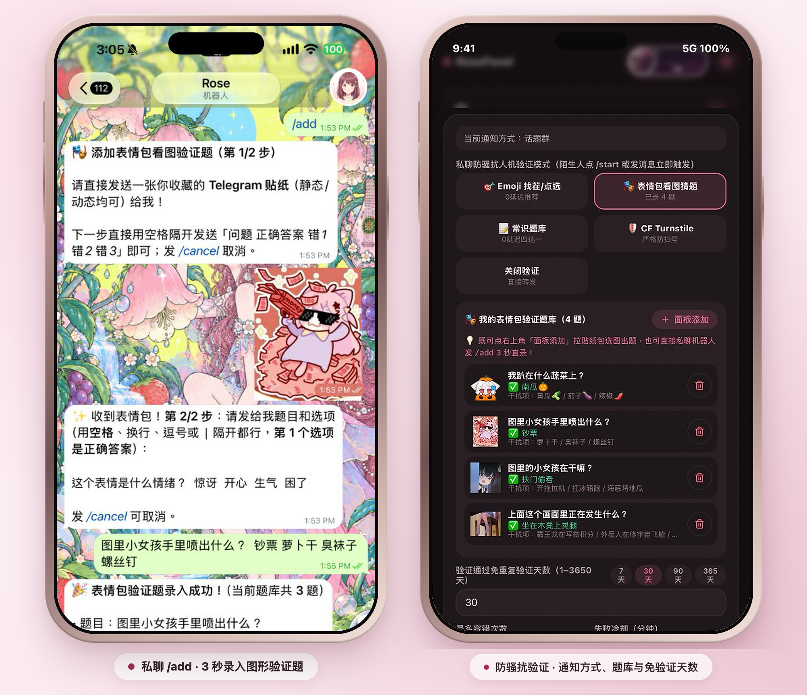
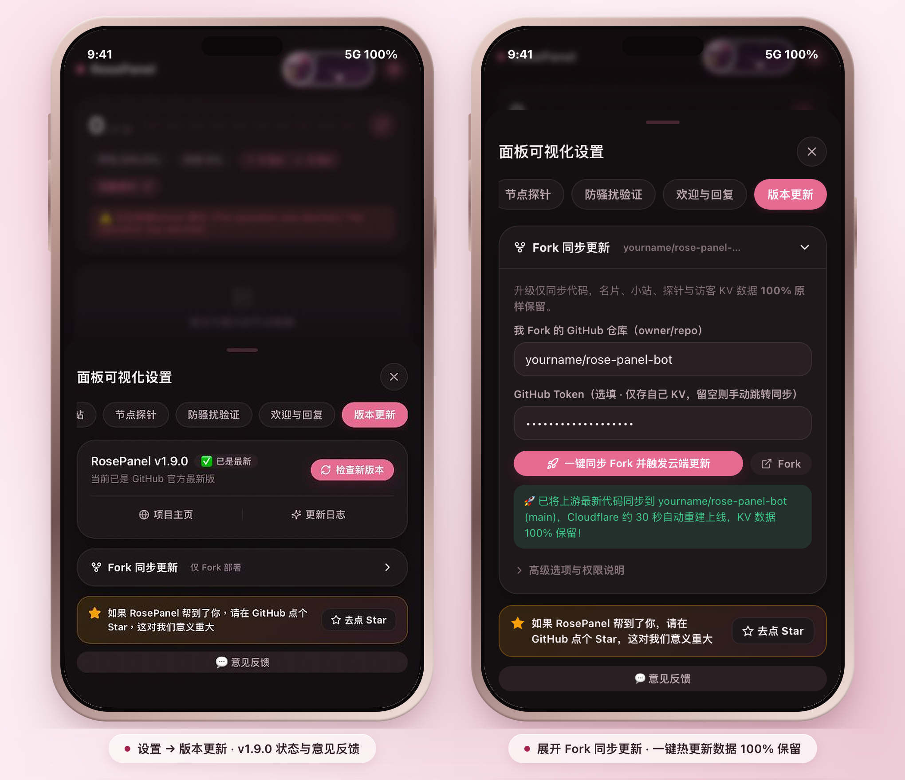
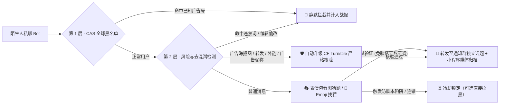

<div align="center">


<br />

[](https://github.com/mango0114/rose-panel-bot/releases)
[](https://github.com/mango0114/rose-panel-bot/stargazers)
[](https://t.me/Rose202_bot)
[](https://workers.cloudflare.com/)
[](https://core.telegram.org/bots/webapps)
[](LICENSE)

<p>
  <b>🇨🇳 简体中文</b> ·
  <a href="README_EN.md">🇺🇸 English</a> ·
  <a href="docs/SETUP_GUIDE.md">🐣 零基础 5 分钟教程</a> ·
  <a href="AGENTS.md">🤖 AI 一键部署协议</a> ·
  <a href="CHANGELOG.md">📋 更新日志</a> ·
  <a href="https://t.me/Rose202_bot">💬 在线体验 / 联系作者</a> ·
  <a href="#-赞助与支持">🧧 赞助支持</a>
</p>

<sub><b>在面板里直接聊天、发图的防广告 Telegram 私聊机器人</b> — 面板内看记录、相册发图与撤回 · 四层防护 + 4 种人机验证（含动图题）· 免会员自定义回复 · 附带 <b>0.2 秒启动个人面板</b>（多协议探针模块 / 网站书签 / 像素昼夜滑块），Cloudflare Workers 免费部署</sub>

</div>

> - **🔄 部署前必看（Fork 才能一键同步更新）**：**强烈建议先点击右上角 `Fork` 仓库，再导入 Cloudflare Workers 部署**——只有通过 Fork 部署，后续才能在 TG 面板里**一键同步更新**（KV 数据 100% 保留）；「检查新版本」所有部署方式均可用，但直接复制的独立仓库没有 GitHub `Sync fork`，需按教程 FAQ 手动合并上游。
> - **🔒 零数据收集承诺**：不经过作者或任何第三方中转，所有 Token、配置、小站与访客记录 **100% 保存在你自己的 Cloudflare Workers + KV**，代码全开源可审计（仅在开启对应功能时请求公开只读 CAS、CF Turnstile 或 GitHub 公开 Release 接口）。
> - **🧭 快速上手**：[🐣 零基础 5 分钟教程](docs/SETUP_GUIDE.md) · [⚡ 老手 1 分钟速通](docs/SETUP_GUIDE.md#-老手速通通道已有-bot-token--cloudflare) · [🚀 四种部署方式（网页 / AI / 终端 / VPS）](#-极简部署5-分钟免费上线) · [🔄 老用户升级](#-老用户如何升级到最新版100-保留-kv-数据)

---

## 🎬 动态功能演示（三段实机录屏）

### 1 · 面板内直接聊天与手机相册选图发图

<div align="center">
  
</div>

- 点开任意访客资料卡的 **「💬 聊过」** 即可查看最近 60 条双向对话气泡，**直接在小程序内打字、从手机相册任意选图（JPG / PNG / WebP / GIF，单张 ≤ 10 MB）发送，并支持一键双向撤回**；
- 发出的图文自动静默抄送至管理群对应话题（私密话题群发一句 `/bind` 即完成绑定，话题内支持 `/del` 撤回），两边随时无缝接力，往来图片与链接按「对方发来 / 我发出的」自动分类归档。

### 2 · 陌生人首次 `/start` 表情包双题验证（答错换新题）

<div align="center">
  
</div>

- 保存欢迎语自动同步至 Telegram 顶部介绍框；陌生人点「开始」发 `/start` 立即出题：私聊发 `/add` 三秒（或在面板点 **「面板添加」** 拉贴纸包）即可用**静态 / 动态贴纸**出专属看图题；
- **答错就洗牌**：多题立刻换新贴纸、单题则位置重新随机，题底带防脚本蜜罐陷阱（默认冷却防误触，切拉黑亦可在访客列表一键解封）；通过后 1–3650 天免验证直通私聊，并触发**免会员自动回复与最多 50 条关键词秒回**。

### 3 · 0.2 秒启动个人面板 & 224×84 像素昼夜气泡滑块

<div align="center">
  
</div>

- **224×84 像素昼夜气泡滑块**：顶栏水晶放大镜可拖动切换 **夜晚深色 / 黄昏跟随 Telegram / 白天浅色**，松手以圆形波纹切换全屏主题并同步 TG 原生顶栏；边缘开屏注入 + 本地缓存实现 0.2 秒秒开，升级新版自动弹出 **「✨ 近期更新」** 摘要；
- 往来图片相册按发送方一键筛选；内置 **Komari / 哪吒（v1·v0）/ NodeGet / 通用 JSON** 可插拔探针与 **公开 / 🔒 仅我可见** 双层书签；支持 `/set` 秒换动态贴纸主徽章与 3 选 1 隐私头像代理。

---

## 💬 更多实机亮点：`/add` 出题 · `/set` 动态徽章 · 站内版本更新

<div align="center">
  <p><b>🎭 私聊 <code>/add</code> 三秒录入贴纸验证题 · 全程面板可视化一键开关</b></p>
  
  <br /><br />
  <p><b>✨ 私聊 <code>/set</code> 秒换动态贴纸主徽章 · 收藏徽章库与 0 秒开屏同步</b></p>
  
  <br /><br />
  <p><b>🔄 Fork 部署 · 新版站内提醒 · 一键同步更新（数据 100% 保留）</b></p>
  
</div>

<details>
<summary><b>📱 展开查看四大菜单静态超清实机画廊（名片 · 小站 · 探针 · 暗黑主题）</b></summary>

<br />
<div align="center">
  <p><b>🪪 1 · 玫瑰瓷个人名片与一键发私信　｜　🌐 2 · 公开 / 私密双层个人小站</b></p>
  
  <br /><br />
  <p><b>📡 3 · 多合一节点探针　｜　🛡️ 4 · 四层防广告护盾与访客列表</b></p>
  
  <br /><br />
  <p><b>🌙 暗黑玫瑰瓷主题　｜　🖼️ 往来图片相册与链接清单（按「对方发来 / 我发出的」自动归档）</b></p>
  
</div>
</details>

---

## 🛡️ 四层防骚扰架构 & 4 种人机验证



在小程序 **⚙️ 设置 → 防骚扰验证** 可一键切换 4 种模式（亦可一键关闭验证直转），容错次数、冷却时长、免验证天数与一键常见广告屏蔽词全可视化配置：

| 验证模式 | 原理与体验 | 防刷与防绕过 |
| :--- | :--- | :--- |
| **🎭 表情包看图猜题（私房推荐）** | 私聊发 `/add` 或面板拉贴纸包，用收藏的动图/静图出趣味题，**真人一眼秒过** | 答错就洗牌（多题换新贴纸，单题按钮位置重新随机）；通过后自动清理贴纸 + 蜜罐陷阱与静默冷却 |
| **🎯 Emoji 找茬 / 点选（默认）** | 3×3 纯图标按钮随机交替出题（8 同 1 异或中文提示点选），**0 延迟秒过** | 错 1 次立刻换题打乱，连错达上限（默认 2 次）静默冷却 |
| **📝 常识题库** | 本地 2×2 常识问答按钮，零外部依赖 | 错 1 次换题并重新打乱选项 + 蜜罐 + 静默冷却 |
| **🛡️ CF Turnstile 严格模式** | 遇到定向扫号攻击时一键开启，内嵌 WebApp 完成 Cloudflare `siteverify` 核验 | 未配密钥时自动回退至 Emoji 模式防卡死 |

- **数据与权限安全**：Mini App 接口全量校验 Telegram 官方 `initData` HMAC-SHA256 签名；站长概览采用单键缓存与内存 `<0.1ms` 极速鉴权，日常打开仅需 2 次 KV 读取、0 次 `KV.list`；`BOT_TOKEN` 绝不暴露前端。

---

## 🧩 模块化按需选配

未启用的模块完全隐藏、零额外请求，想只当「轻量化防广告私聊机器人」或「全功能个人主页 + 探针」都可以：

| 模块 | 默认状态 | 开启条件 | 说明 |
| :--- | :---: | :--- | :--- |
| **🪪 个人名片 + 🌐 公开/私密小站** | 核心必选 | `BOT_TOKEN` + `TOPIC_MAP` KV | 0.2 秒玫瑰瓷个人面板、像素昼夜滑块、动态贴纸徽章与双层小站 |
| **👤 双向私聊 + 四层反广告护盾** | 按需选配 | 配好 `ADMIN_IDS` 即开（Bot 私聊直推），或话题群发 `/bind`（可选，推荐高频用户） | 免建群即可收发私信（引用推送回复）、面板内直接聊天发图、往来图片/链接归档、CAS 与表情包验证；话题群 `/bind` 后自动切换为独立话题收件箱 |
| **📡 多协议节点探针** | 按需选配 | 小程序内选类型并填地址 | 支持 **Komari / 哪吒 (v1·v0) / NodeGet / 通用 JSON**，支持「仅自己可见」 |
| **🛡️ CF Turnstile 严格验证** | 按需选配 | 填入 `TURNSTILE_SITE_KEY` & `SECRET` | 高危广告自动升级核验，或在设置里手动切换 |
| **🌸 群签到积分与徽章系统** | 按需选配 | `ENABLE_CHECKIN="true"` 或设置内一键开 | 个人名片模式默认关闭，群社区部署时一键开启 |

---

## 🚀 极简部署（5 分钟免费上线）

> **🐣 第一次申请 Telegram 机器人？** 跟着 **[零基础 5 分钟保姆教程](docs/SETUP_GUIDE.md)** 从 `@BotFather` 拿到第一个 Token 到群内 `/bind` 上线零门槛！

### 方式一：Fork 网页零环境部署（最推荐 ★ · 仅 Fork 部署支持面板内一键同步更新）

1. 点击本页右上角 **Fork**，将 `rose-panel-bot` 复制到你自己的 GitHub 账号下。
2. 打开 Cloudflare Dashboard → **Workers & Pages → Create → Workers → Import a repository**，选择你刚 Fork 的仓库：
   - **Build command**：`npm run build`
   - **Deploy command**：`npx wrangler deploy`
3. 部署后进入 Worker 的 **Settings → Variables & Bindings**，确认绑定了 `TOPIC_MAP` KV，并填入 4 个核心变量：
   - `BOT_TOKEN`（**Secret**）· `WEBHOOK_SECRET`（**Secret**，随机填一串英文数字）
   - `ADMIN_IDS`（**务必选 Text 文本变量**，填你的纯数字 UID）· `BOT_USERNAME`（**Text**，不含 `@`）
4. 浏览器访问一次 `https://<你的Worker域名>/setup?secret=<WEBHOOK_SECRET>` 看到 `"ok": true` 即上线！此时给你的 Bot 发一次 `/start` 即可直接启用 **Bot 私聊直推**（配好 `ADMIN_IDS` 就能收发私信与开启人机验证，无需建群）；*(可选 · 推荐高频用户)* 如需为每位访客分独立话题，再建开启「话题 (Topics)」的私密群、把机器人设为管理员后发一句 **`/bind`** 即可自动切换！
5. *(推荐)* 在 `@BotFather` 发 `/newapp`，URL 填 `https://<你的Worker域名>/`，短名与 `APP_SHORT_NAME` 一致（如 `panel`），群内与话题按钮才能直接打开面板。

> 💡 **为什么不直接用一键部署按钮？** Cloudflare 一键按钮会建一个**独立副本（非 Fork）**，后续既没有 GitHub `Sync fork` 按钮，也无法在 TG 面板里一键同步更新；先点右上角 Fork 再导入只需多点一下，以后永久省心。

### 方式二：AI 懒人按需部署（Antigravity / Claude Code / Codex / Cursor）

仓库根目录内置标准 **[AGENTS.md](AGENTS.md)**，把仓库丢给 AI 助手直接说：

```text
请阅读仓库里的 AGENTS.md，先询问我需要开启哪些模块（或选择轻量化安装），再帮我一步步部署 RosePanel Bot。
```

### 方式三：开发者终端 5 行速通（macOS / Windows / Linux 通用，全程不点网页）

```bash
# 1. 拉取代码并安装依赖（需 Node.js 20+）
git clone https://github.com/mango0114/rose-panel-bot.git && cd rose-panel-bot && npm ci

# 2. 登录 Cloudflare 并构建部署（Wrangler v4 自动创建 TOPIC_MAP KV）
npx wrangler login
npm run build && npx wrangler deploy --var ADMIN_IDS:你的数字UID --var BOT_USERNAME:你的Bot用户名

# 3. 写入两个核心 Secret（按提示粘贴即可）
npx wrangler secret put BOT_TOKEN && npx wrangler secret put WEBHOOK_SECRET

# 4. 激活 Webhook 与菜单（看到 {"ok":true,...} 即上线；话题群内再发 /bind 绑收件箱）
curl -s "https://<你的Worker域名>/setup?secret=<你的WEBHOOK_SECRET>"
```

<details>
<summary><b>🛠️ 展开查看 Windows / macOS 环境安装命令</b></summary>

- **Windows (PowerShell)**：`winget install --id Git.Git -e && winget install --id OpenJS.NodeJS.LTS -e`
- **macOS (Terminal)**：`brew install git node`
</details>

### 方式四：Linux VPS / Docker / 纯自托管

<details>
<summary><b>🐧 展开查看 Linux 依赖安装、无浏览器推送、Docker 与纯 VPS 自托管命令</b></summary>

#### 1. 安装 Git & Node.js 22
- **Debian / Ubuntu**：`sudo apt update && sudo apt install -y curl git ca-certificates && curl -fsSL https://deb.nodesource.com/setup_22.x | sudo -E bash - && sudo apt install -y nodejs`
- **CentOS / Rocky / Alma**：`sudo dnf install -y curl git && curl -fsSL https://rpm.nodesource.com/setup_22.x | sudo bash - && sudo dnf install -y nodejs`
- **Arch**：`sudo pacman -Syu --noconfirm git nodejs npm` ｜ **Alpine**：`apk add --no-cache git nodejs npm`

#### 2. 无浏览器 VPS 推送到 Cloudflare Workers
```bash
git clone https://github.com/mango0114/rose-panel-bot.git && cd rose-panel-bot && npm ci
export CLOUDFLARE_API_TOKEN="你的_Cloudflare_API_Token"
npm run build && npx wrangler deploy --var ADMIN_IDS:你的数字UID --var BOT_USERNAME:你的Bot用户名
echo "你的_BOT_TOKEN" | npx wrangler secret put BOT_TOKEN
echo "你的随机_WEBHOOK_SECRET" | npx wrangler secret put WEBHOOK_SECRET
curl -s "https://<你的Worker域名>/setup?secret=<你的WEBHOOK_SECRET>"
```

#### 3. Docker 一行部署（不污染宿主机）
```bash
git clone https://github.com/mango0114/rose-panel-bot.git && cd rose-panel-bot
docker run --rm -it -v "$PWD":/app -w /app -e CLOUDFLARE_API_TOKEN="你的_API_Token" node:22-alpine \
  sh -c "npm ci && npm run build && npx wrangler deploy --var ADMIN_IDS:你的数字UID --var BOT_USERNAME:你的Bot用户名"
```

#### 4. 纯 VPS 自托管（配合 Caddy 自动 HTTPS）
```bash
npm ci && npm run build && cp .dev.vars.example .dev.vars
# 编辑 .dev.vars 填入真实变量（DEV_PREVIEW 仅在 localhost 生效，生产保持 "false"）
npx wrangler dev --ip 127.0.0.1 --port 8787 --persist-to ./.wrangler/state --show-interactive-dev-session=false
```
再用 Caddy 反向代理 `reverse_proxy 127.0.0.1:8787` 绑定 HTTPS 域名即可。
</details>

---

## 🔄 老用户如何升级到最新版（100% 保留 KV 数据）

> **✅ 无需修改 Cloudflare KV！** 升级只更新代码，原有的名片、小站、探针、访客与通知群绑定 **100% 原样保留**（`wrangler.toml` 已开启 `keep_vars = true`，重部署不误清普通变量）。⚠️ **切勿新建 Worker 或重新点击一键部署按钮**，否则会建出全新的空实例。

- **🔀 Fork 部署用户（最简单）**：打开小程序 **⚙️ 设置 → 版本更新** 点 **「检查新版本」**；在「我 Fork 的 GitHub 仓库」填入 `你的用户名/rose-panel-bot` 后，点 **「前往我的 Fork 点 Sync fork」**（零密钥），或再填单仓 Fine-grained Token 点 **「一键同步 Fork 并触发云端更新」**，约 30 秒云端重建上线。
- **🤖 独立副本 / AI 部署用户**：把下面这段话发给你的 AI 助手：
  ```text
  请阅读 https://github.com/mango0114/rose-panel-bot 的 AGENTS.md，帮我把之前部署的 RosePanel Bot 升级到最新版：把上游最新代码合并进我自己的 GitHub 仓库并推送，让 Cloudflare 自动重建。不要新建 Worker、KV 或 Bot；如果必须用 wrangler 部署，先确认 Worker 名称和 wrangler.toml 里的 KV ID 与我原来的一致并用 --keep-vars。
  ```
- **💻 本地 CLI 用户**：在项目目录执行 `git pull && npm ci && npm run build && npx wrangler deploy --keep-vars`。

---

## ⚙️ 环境变量一览

| 变量名 | 类型 | 必填 | 说明 |
| :--- | :--- | :---: | :--- |
| `TOPIC_MAP` | KV Binding | ✅ | 持久化面板配置、小站、访客与媒体归档、签到数据 |
| `BOT_TOKEN` | Secret | ✅ | `@BotFather` 颁发的 Telegram Bot Token |
| `ADMIN_IDS` | Text | ✅ | 站长数字 UID，多个用英文逗号分隔（`<0.1ms` 内存极速鉴权） |
| `WEBHOOK_SECRET` | Secret | ✅ | 随机密钥，保护 Webhook（含 `/` 与 `/webhook`）与 `/setup` |
| `BOT_USERNAME` | Text | 推荐 | 机器人用户名（不含 `@`） |
| `APP_SHORT_NAME` | Text | 推荐 | BotFather `/newapp` 设置的小程序短名（如 `panel`） |
| `SUPERGROUP_ID` | Text | 可选 | 话题通知群 ID（不绑群时只要配了 `ADMIN_IDS` 即自动走 Bot 私聊直推；高频用户推荐在话题群发 `/bind` 绑定，免手填。注：私聊直推模式每条访客消息会多 1～3 次 KV 写入，Cloudflare 免费额度 1000 次/天，个人日常使用充足） |
| `TURNSTILE_SITE_KEY` / `TURNSTILE_SECRET` | Text / Secret | 可选 | 开启 CF Turnstile 严格验证模式时填写 |
| `PROBE_PROVIDER` | Text | 可选 | 探针类型：`komari`（默认）/ `nezha` / `nodeget` / `json` |
| `PROBE_URL` / `PROBE_API_KEY` | Text / Secret | 可选 | 探针地址与私有凭证（兼容旧名 `KOMARI_URL` / `KOMARI_API_KEY`，也可在小程序内填写） |

---

## 🤖 常用指令

- **通用**：`/start` · `/panel` · `/me` · `/checkin`（群社区模式）· `/rank`（群社区模式）
- **站长私聊**：`/set`（秒设动态贴纸主徽章）· `/add`（录入收藏表情包看图验证题）· `/resetbadge` · `/cancel`；未绑群走私聊直推时，引用推送消息也可直接发 `/del` `/info` `/ban` `/unban` `/trust` `/reset` `/close` `/open`
- **通知群话题内（可选）**：`/bind`（一键绑定通知群，自动切话题模式）· `/unbind`（解绑回退私聊直推）· `/del`（回复消息撤回私聊）· `/info` · `/ban` · `/unban` · `/trust` · `/reset` · `/close` · `/open`

---

## 🙏 致谢与技术栈

- 协议适配与兼容：[Komari Monitor](https://github.com/komari-monitor/komari) · [Combot Anti-Spam (CAS)](https://cas.chat/) · [jikssha/telegram_private_chatbot](https://github.com/jikssha/telegram_private_chatbot)
- 开源基础设施：[Cloudflare Workers](https://workers.cloudflare.com/) · [Telegram Mini Apps](https://core.telegram.org/bots/webapps) · [React](https://react.dev/) · [Vite](https://vitejs.dev/) · [Lucide Icons](https://lucide.dev/) · [lottie-web](https://github.com/airbnb/lottie-web)

---

## 🧧 赞助与支持

本项目以 MIT 协议完全免费开源，零付费墙、零数据收集。如果你喜欢 **RosePanel Bot**，或者它帮你挡掉了恼人的 TG 广告骚扰，欢迎请作者喝杯咖啡 / 投喂一点 AI 算力，支持项目持续迭代 ☕✨

- **在线体验 & 联系作者**：👉 **[@Rose202_bot](https://t.me/Rose202_bot)**（可亲手体验 0.2 秒启动个人面板与表情包看图验证）
- **支付宝口令红包赞助（保护双方隐私）**：
  1. 在支付宝生成一个任意金额的 **「口令红包」**；
  2. 私聊 **[@Rose202_bot](https://t.me/Rose202_bot)** 通过验证后，发送 **口令 + 你想展示在名单中的昵称与留言**（支持匿名）；
  3. 收到后会第一时间将你的支持记录到下方赞助者名单中！

### 🏆 赞助者名单

<details open>
<summary><b>展开查看完整赞助者名单（虚位以待 🌸）</b></summary>

| 序号 | 赞助者 | 金额 | 留言 |
| :---: | :---: | :---: | :--- |
| 1 | *虚位以待* | — | 成为第一位支持者，点亮开源赞助墙 ✨ |

</details>

---

## 🌟 Star History

<a href="https://www.star-history.com/#mango0114/rose-panel-bot&Date">
 <picture>
   <source media="(prefers-color-scheme: dark)" srcset="https://api.star-history.com/svg?repos=mango0114/rose-panel-bot&type=Date&theme=dark" />
   <source media="(prefers-color-scheme: light)" srcset="https://api.star-history.com/svg?repos=mango0114/rose-panel-bot&type=Date" />
   
 </picture>
</a>

---

<div align="center">
  <br />
  <b>⭐ 如果这个项目对您有帮助，请给个 Star 支持一下！</b><br /><br />
  <sub>MIT License © 2026 <a href="https://github.com/mango0114">mango0114</a></sub>
</div>
