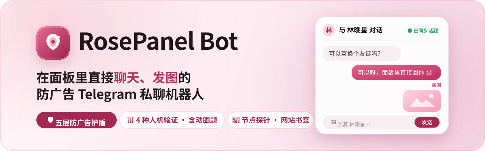
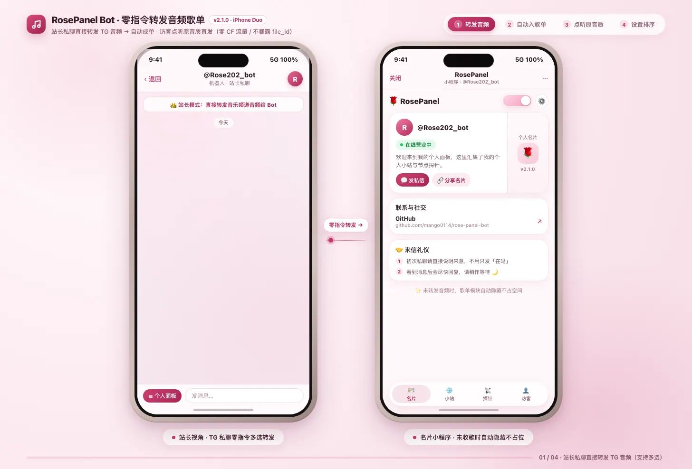
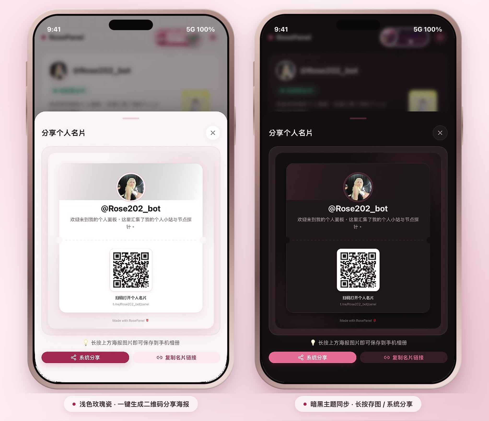
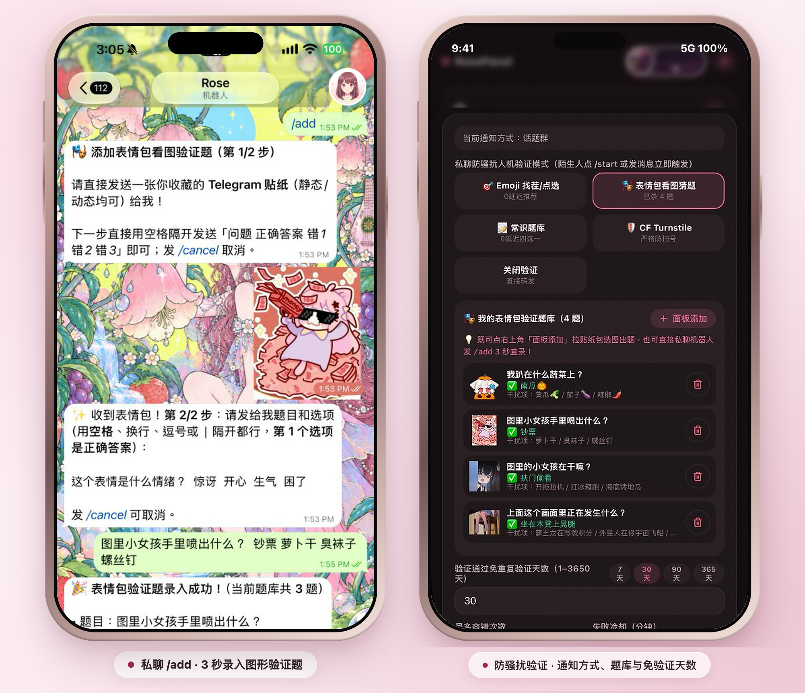
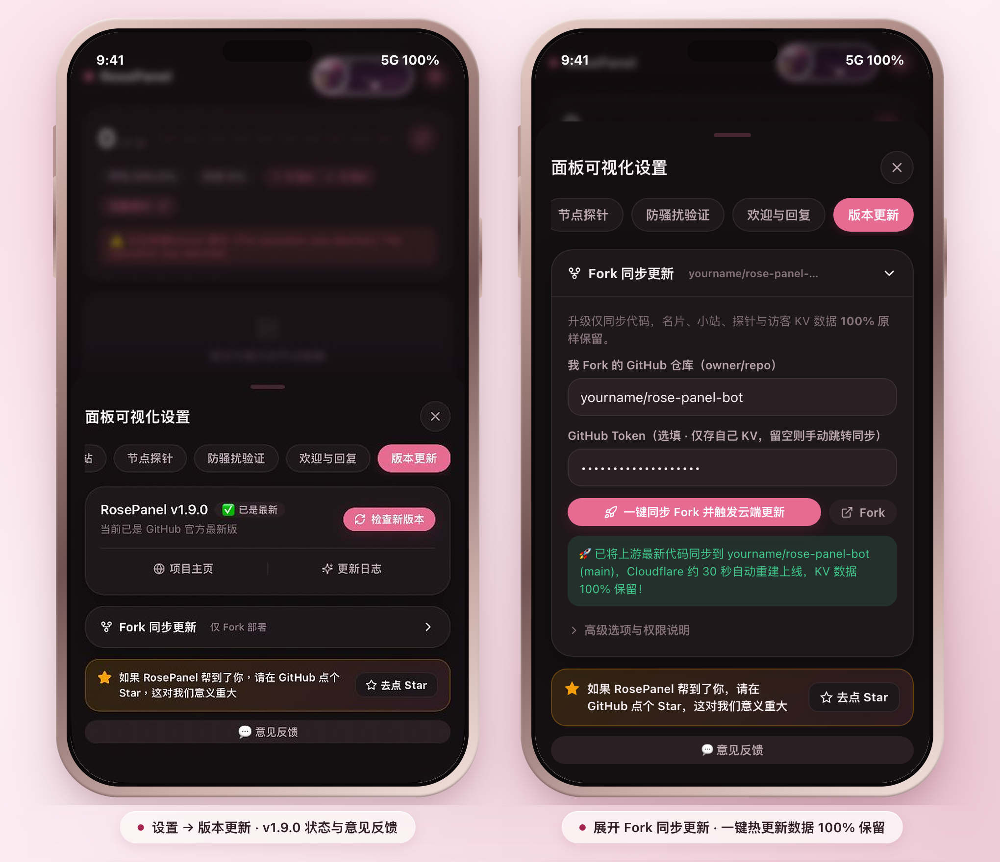
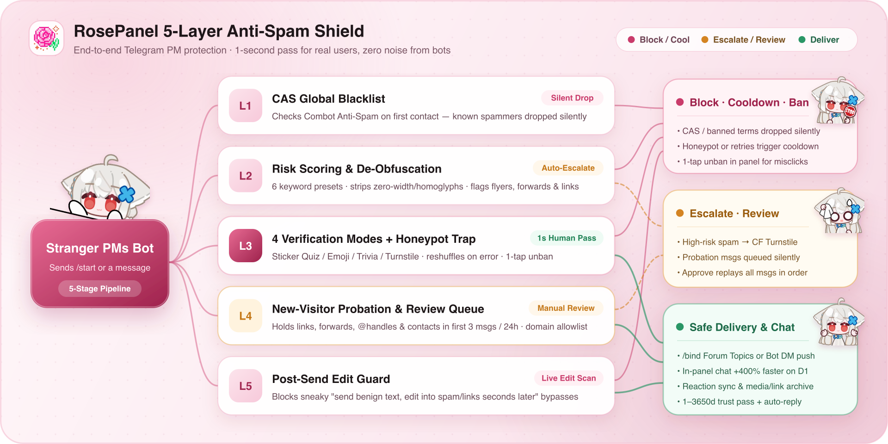

<div align="center">



<br />

[](https://github.com/mango0114/rose-panel-bot/releases)
[](https://github.com/mango0114/rose-panel-bot/stargazers)
[](https://t.me/Rose202_bot)
[](https://workers.cloudflare.com/)
[](https://core.telegram.org/bots/webapps)
[](LICENSE)

<p>
  <a href="README.md">🇨🇳 简体中文</a> ·
  <b>🇺🇸 English</b> ·
  <a href="docs/SETUP_GUIDE.md">🐣 Beginner Guide (ZH)</a> ·
  <a href="AGENTS.md">🤖 AI Auto-Deploy</a> ·
  <a href="CHANGELOG.md">📋 Changelog</a> ·
  <a href="https://t.me/Rose202_bot">💬 Live Demo</a> ·
  <a href="#sponsor">🧧 Sponsors</a>
</p>

<sub><b>Zero-group Anti-Spam Telegram PM Bot where you chat, view stickers & send photos right inside the panel</b> — +400% Faster In-Panel Chat Sync + Full-History Pagination & Search on Cloudflare D1 · Awaiting-Reply Tracking & 1-Tap Scene Statuses (12 Built-in Animated Stickers) · Bidirectional Emoji Reaction Sync · 5-Layer Shield + 4 Verification Modes · Includes a <b>0.2-Second Personal Panel</b> (5 Themes & Glass Dock / Zero-Command Forwarded Audio Playlist / Shareable QR Poster / Multi-Protocol Probe with Alerts / Site Bookmarks / Pixel Day-Night Slider) on Cloudflare Workers Free Tier</sub>

</div>

> - **🔄 Fork First for 1-Click Updates (Important)**: **Always click `Fork` at the top right before importing into Cloudflare Workers** — only Fork-based deployments support **1-click in-panel Fork sync updates** (100% KV data preserved). Release checks work for every deployment, but standalone copies have no GitHub `Sync fork` and must merge upstream manually (see the guide's FAQ).
> - **🔒 Zero Data Collection Promise**: Zero third-party relays — your Bot Token, config, sites, and visitor archive live **100% inside your own Cloudflare Workers & KV / D1** (external calls occur only when enabled for read-only CAS, CF Turnstile, or public GitHub Release checks).
> - **🧭 Quick Links**: [🎒 4 Things Ready in 1 Min & Fast Deploy](#deploy) · [🔄 Safe Upgrade Guide](#upgrade) · [🐣 Beginner Guide (ZH)](docs/SETUP_GUIDE.md)

---

##  Live Motion Showcase (4 Animated Walkthroughs)

### 1 · Direct In-Panel Chat & Phone Album Photo Replies

<div align="center">
  
</div>

- Tap **`💬 聊过` (Chat)** on any visitor card to view the last 60 two-way bubbles, **type text, pick any photo from your phone album (JPG / PNG / WebP / GIF, up to 10 MB), view signed static/video/Lottie stickers directly inside the chat, and recall messages in 1 tap**;
- **Works out-of-the-box without a group**: set `ADMIN_IDS` for Bot DM direct push (quote-reply to respond), or send `/bind` in a private Topics group anytime to switch into per-visitor Forum Topics (`/del` recalls from topics); **syncs emoji reactions bidirectionally** between visitor PMs and admin inbox, while photos & links auto-archive by sender (`Visitor` / `Me`).

### 2 · First-Time Stranger `/start` Sticker Quiz (Auto-Switch on Wrong Tap)

<div align="center">
  
</div>

- Saving your welcome text auto-syncs Telegram's pre-Start intro box; strangers tapping **Start** (`/start`) get challenged immediately — send `/add` in PM (or pull any sticker pack inside Settings) to turn **static or animated stickers** into visual quizzes in 3 seconds;
- **Reshuffle on error**: multi-quiz banks immediately switch to another sticker (single-quiz banks re-randomize button order) with a script-trap decoy; passing grants 1–3650 days of direct PM access with optional **auto-reply & up to 50 keyword rules**.

### 3 · 0.2-Second Personal Panel & 224×84 Pixel Day/Night Bubble Slider

<div align="center">
  
</div>

- **224×84 Pixel Day/Night Bubble Slider & 5 Themes + Frosted Glass Dock**: scrub the crystal magnifier to toggle **Dark / Follow Telegram / Light** with a full-screen circular View Transition ripple synced to Telegram chrome; choose from **5 palettes (Rose / Ocean / Matcha / Lavender / Mono)** and **Solid / Frosted Glass** bottom dock styles with 0ms edge-injected splash and **customizable bottom navigation order & default landing tab**;
- **Portable Playlist on the Go & 1-Tap Scene Statuses**: whenever you hear a track you like on Telegram (music channels, groups, or music bots), just forward it directly to your own bot (multi-select supported) and your card automatically organizes it into a **"🎵 Recently Listening"** playlist (auto-hidden when empty; visitors tap **"🎧 听这首"** for zero-egress native `sendAudio` playback with `/start song_<id>` deep-link fallback and zero `file_id` exposure); tap the card status pill for 1-tap scene presets, 12 built-in animated stickers (no Telegram Premium required), and isolated temporary auto-replies;
- Filter exchanged photos by sender, with **unlimited cursor pagination & full-history message search** when D1 is bound; inspect live **Komari / Nezha (v1·v0) / NodeGet / Generic JSON** server metrics (with per-line **latency & packet loss display** for Komari — requires adding Ping Tasks in the Komari dashboard, currently Komari-only — plus optional offline & resource alerts, off by default) and **Public / 🔒 Private** site bookmarks; generate **light/dark shareable QR card posters with Open Graph previews, `src_` referral tracking, and monthly unique visitor counts**; swap animated `.webp` / `.webm` / `.tgs` emblems via `/set` with 3-way private avatar options.

### 4 · Portable Playlist: Forward Songs Anywhere → Auto-Organized Card & Native Playback (iPhone Duo)

<div align="center">
  
</div>

- **Forward anywhere, auto-organized**: Whenever you come across a track you like on Telegram (music channels, groups, music bots, or friends — multi-select supported), simply forward the native audio directly to your bot in private chat (non-reply) with zero commands. RosePanel automatically organizes it into your card's **"🎵 Recently Listening"** playlist with title, artist, duration, and optional public channel post link (auto-hidden when empty, with a 1-tap `🗑️ Remove` undo button on the receipt).
- **Zero-egress native delivery**: Visitors tap **"🎧 听这首"** to receive original-quality audio directly via Telegram `sendAudio` (zero Cloudflare egress, raw `file_id` never exposed to clients; cold visitors automatically fall back to `/start song_<id>` without bypassing PM verification), while owners can toggle visibility, rename, reorder, or delete tracks inside Settings.

---

##  More Highlights: Share Poster · `/add` Quizzes · `/set` Animated Emblems · 1-Click Fork Sync

<div align="center">
  <p><b>🪪 One-Tap Light & Dark QR Share Posters · Long-Press Save / Native Share / Copy Link</b></p>
  
  <br /><br />
  <p><b>🎭 3-Second Sticker Quizzes via <code>/add</code> · Full Visual Anti-Spam Controls</b></p>
  
  <br /><br />
  <p><b>✨ Animated Sticker Emblems via <code>/set</code> · Saved Collection & 0ms Edge Splash</b></p>
  
  <br /><br />
  <p><b>🔄 Fork Deploy · In-App Update Check & Feedback · 1-Click Fork Sync (100% Data Preserved)</b></p>
  
</div>

<details>
<summary><b>📱 Expand 4-Tab Retina Static Mini App Gallery (Card · Sites · Probe · Dark Theme)</b></summary>

<br />
<div align="center">
  <p><b>🪪 1 · Personal Card & Direct PM Wake-Up　｜　🌐 2 · Public & Private Dual-Layer Sites</b></p>
  
  <br /><br />
  <p><b>📡 3 · Multi-Protocol Probe　｜　🛡️ 4 · 5-Layer Anti-Spam & Visitor List</b></p>
  
  <br /><br />
  <p><b>🌙 Dark Rose-Obsidian Theme　｜　🖼️ Exchanged Photos Gallery & Link Archive (Filtered by Sender)</b></p>
  
</div>
</details>

> **🚀 Ready to deploy your own for free on Cloudflare?** → **[Grab the 4 items in 1 min & go live in 4 steps](#deploy)**

---

##  5-Layer Anti-Spam Architecture & 4 Verification Modes

<div align="center">
  
</div>

Switch anytime inside **⚙️ Settings → 防骚扰验证 (Anti-Spam Verification)** (or disable verification for direct forwarding), with visual controls for **New Visitor Probation** (holds links, `@username` mentions, contact info, or forwarded messages from newly verified visitors for silent admin approval/ban with domain allowlists and ordered replay — zero message loss) and **6 grouped ad-phrase blocked keyword presets** (all off by default, toggle per phrase or add by group):

| Mode | Experience & Mechanism | Anti-Abuse Protection |
| :--- | :--- | :--- |
| **🎭 Custom Sticker Quiz (Recommended)** | Use `/add` or the in-panel sticker pack picker to turn animated/static stickers into visual quizzes — **1s for humans** | Reshuffle on error (switches stickers in multi-quiz banks, re-randomizes button positions in single-quiz banks); auto-cleans sticker + honeypot & cooldown |
| **🎯 Emoji Odd-One-Out / Pick (Default)** | 3×3 pure-icon inline grid alternating odd-one-out and semantic pick — **zero latency** | Reshuffles on first mistake; consecutive failures trigger silent cooldown (configurable) |
| **📝 Local Quiz** | 2×2 local commonsense buttons, zero external calls | New question with reshuffled options on error + honeypot + silent cooldown |
| **🛡️ CF Turnstile Strict Mode** | 1-tap escalation during raids; native Cloudflare Turnstile inside Telegram WebApp with server-side `siteverify` | Auto-falls back to Emoji mode if Turnstile keys aren't set |

- **Security & Performance**: Full Telegram `initData` HMAC-SHA256 verification; `<0.1ms` in-memory admin auth + single-key overview cache (2 KV reads, 0 `KV.list` on normal load); `BOT_TOKEN` never touches the frontend.

---

##  Modular Add-Ons

Unused modules stay completely hidden and add zero overhead:

| Module | Default | Activation | Notes |
| :--- | :---: | :--- | :--- |
| **🪪 Personal Card + 🌐 Public/Private Sites** | Core | `BOT_TOKEN` + `TOPIC_MAP` KV | 0.2s panel with 5 palettes & frosted glass dock, pixel Day/Night slider, animated emblems, 1-tap scene statuses (12 built-in animated stickers), **zero-command forwarded audio playlist (`sendAudio` zero-egress delivery, auto-hidden when empty)**, dual-layer sites, shareable QR poster, Open Graph previews, `src_<channel>` referral tracking, and per-user monthly visitor counts (admin-only by default) |
| **👤 Bidirectional PM Bot + 5-Layer Shield** | Optional | Works with `ADMIN_IDS` (Bot DM push), or `/bind` in a Topics group (optional, recommended for high volume) | Ready out-of-the-box via Bot DM push (quote-reply to respond), direct in-panel chat/photos & signed sticker rendering (+400% faster chat sync, unlimited pagination & full-history search on D1), awaiting-reply tracking, bidirectional emoji reaction sync, archive, CAS + sticker quizzes + probation review; `/bind` switches automatically to per-visitor Forum Topics |
| **📡 Pluggable Server Probe** | Optional | Pick provider & URL in Mini App | **Komari / Nezha (v1·v0) / NodeGet / Generic JSON**; per-line **latency & packet loss display** (requires configuring Ping Tasks in the Komari dashboard; currently Komari-only), Admin-Only toggle & optional offline/resource alerts (off by default) |
| **🛡️ CF Turnstile Strict Mode** | Optional | `TURNSTILE_SITE_KEY` & `SECRET` | Auto-escalates high-risk ads or toggle manually in Settings |
| **🌸 Group Check-in, Points & Badges** | Optional | `ENABLE_CHECKIN="true"` or in-app switch | Off by default for personal cards; 1-click on for group communities |

---

<a id="deploy"></a>
##  Fast Deployment (Free on Cloudflare)

> **🐣 First Telegram bot?** Grab the 4 items below first, then follow the 4 steps (around **10–20 minutes** from scratch, or check the **[Beginner Guide (ZH)](docs/SETUP_GUIDE.md)**).

###  Before You Start: 4 Values Ready in 1 Minute (Everything Else Auto-Provisions)

| Item | Cloudflare Type | Where to Get It | ⚠️ Watch Out |
| :--- | :---: | :--- | :--- |
| **`BOT_TOKEN`** | **Secret** | Open **[@BotFather](https://t.me/BotFather)** on Telegram → send `/newbot` (or `/mybots → API Token`) | **Never share publicly or commit to GitHub** |
| **`BOT_USERNAME`** | **Text** | The bot username you just chose in `@BotFather` (ends with `bot`, e.g. `my_rose_bot`) | **Omit the leading `@`** |
| **`ADMIN_IDS`** | **Text** | Open **[@userinfobot](https://t.me/userinfobot)** → tap **Start**, copy the **numeric `Id`** | Use **your personal** numeric ID (not the bot's); **must be Text, not Secret** or ⚙️ Settings won't appear |
| **`WEBHOOK_SECRET`** | **Secret** | **No dashboard lookup needed — make up any password yourself** (e.g. `rose2026pass`) | Use **letters, digits, `-`, `_` only** (no spaces or `& ? #`); needed for `/setup` in Step 4 |

### Option 1: Fork + Cloudflare Web Deploy (Recommended ★ · 4 Steps)

1. **Fork first**: Click **Fork** at the top right to copy `rose-panel-bot` into your GitHub account (**⚠️ always Fork first** — only Forks support 1-click in-panel updates).
2. **Import into Cloudflare**: Open Cloudflare Dashboard → **Workers & Pages → Create → Workers → Import a repository**, pick your fork, keep **Build command** `npm run build` and **Deploy command** `npx wrangler deploy`, then click **Save and Deploy** (**first deploy auto-creates `TOPIC_MAP` KV and the `rose-panel-bot` D1 database**).
3. **Add the 4 variables**: Go to Worker **Settings → Variables & Bindings**, add the 4 items from the table above with their exact **Secret / Text** types, and click **Deploy / Save**.
4. **Activate via `/setup`**: Open once in your browser:
   ```text
   https://<your-worker-domain>/setup?secret=<YOUR_WEBHOOK_SECRET>
   ```
   Once you see **`"ok": true`**, you're **🎉 live!** Send `/start` to your bot in Telegram PM to enable zero-group DM push and open your personal panel from the bottom-left button.

<details>
<summary><b>✨ Optional Next Steps (/newapp Direct Links · /bind Topics Group · Manual D1 Binding · Multi-Instance Note)</b></summary>

- **Direct-link Mini App for QR posters & group buttons (Recommended)**: Send `/newapp` to `@BotFather` with URL `https://<your-worker-domain>/` and short name `panel`, then add Text variable `APP_SHORT_NAME = panel`.
- **Per-visitor Forum Topics (Optional, great for high volume)**: Create a private group with **Topics** enabled → add the bot as Admin (*Manage Topics* + *Delete Messages*) → send **`/bind`** inside the group to auto-switch (send `/unbind` anytime to return to DM push).
- **Migrating from another TG PM bot (e.g. `nfd` / `telegram_private_chatbot`)**: No need to create a new bot or group — deploy a new Worker (keep the old one for rollback), reuse your existing `BOT_TOKEN` / `ADMIN_IDS` with a new `WEBHOOK_SECRET`, visit `/setup`, and send `/bind` in your existing Topics group (`telegram_private_chatbot` users can also bind their existing `TOPIC_MAP` KV to keep bans and topic mappings).
- **Missing `DB` binding?** Wrangler v4 auto-provisions it by default; if `DB` is absent, see [manual D1 binding steps](docs/SETUP_GUIDE.md#d1-storage) (or keep running seamlessly on KV).
- **⚠️ Multiple instances on one Cloudflare account**: When `database_id` is omitted, Wrangler matches D1 databases by `database_name`. If you deploy a 2nd instance on the same Cloudflare account, change `database_name` in its `wrangler.toml` (e.g. `rose-panel-bot-2`) so instances don't share one database.
- **Why Fork instead of a 1-click template button?** Standalone template copies aren't GitHub Forks, so GitHub `Sync fork` and in-panel 1-click Fork sync won't work on them.
</details>

### Option 2: AI-Guided Modular Deploy (Antigravity / Claude Code / Codex / Cursor)

Open this repository (includes [AGENTS.md](AGENTS.md)) and ask your AI assistant:

```text
Read AGENTS.md in this repo, ask me which modules I want (or if I prefer a lightweight install), and guide me through deploying RosePanel Bot.
```

### Option 3: 5-Line Terminal Quickstart (macOS / Windows / Linux — Zero Dashboard Clicking)

```bash
# 1. Clone & install dependencies (Node.js 20+)
git clone https://github.com/mango0114/rose-panel-bot.git && cd rose-panel-bot && npm ci

# 2. Login & deploy (Wrangler v4 auto-provisions TOPIC_MAP KV and rose-panel-bot D1 DB)
npx wrangler login
npm run build && npx wrangler deploy --var ADMIN_IDS:YOUR_NUMERIC_UID --var BOT_USERNAME:YOUR_BOT_USERNAME

# 3. Set the 2 secrets interactively
npx wrangler secret put BOT_TOKEN && npx wrangler secret put WEBHOOK_SECRET

# 4. Register webhook & bot menu (expect {"ok":true,...}; then send /bind in your Topics group)
curl -s "https://<your-worker-domain>/setup?secret=<YOUR_WEBHOOK_SECRET>"
```

<details>
<summary><b>🛠️ Expand Windows / macOS Git & Node.js Install Commands</b></summary>

- **Windows (PowerShell)**: `winget install --id Git.Git -e && winget install --id OpenJS.NodeJS.LTS -e`
- **macOS (Terminal)**: `brew install git node`
</details>

### Option 4: Linux VPS / Docker / Self-Hosted

<details>
<summary><b>🐧 Expand Linux Prerequisites, Headless Deploy, Docker & Self-Hosted Caddy Guide</b></summary>

#### 1. Install Git & Node.js 22
- **Debian / Ubuntu**: `sudo apt update && sudo apt install -y curl git ca-certificates && curl -fsSL https://deb.nodesource.com/setup_22.x | sudo -E bash - && sudo apt install -y nodejs`
- **CentOS / Rocky / Alma**: `sudo dnf install -y curl git && curl -fsSL https://rpm.nodesource.com/setup_22.x | sudo bash - && sudo dnf install -y nodejs`
- **Arch**: `sudo pacman -Syu --noconfirm git nodejs npm` | **Alpine**: `apk add --no-cache git nodejs npm`

#### 2. Headless VPS Deploy to Cloudflare Workers
```bash
git clone https://github.com/mango0114/rose-panel-bot.git && cd rose-panel-bot && npm ci
export CLOUDFLARE_API_TOKEN="YOUR_CLOUDFLARE_API_TOKEN"
npm run build && npx wrangler deploy --var ADMIN_IDS:YOUR_NUMERIC_UID --var BOT_USERNAME:YOUR_BOT_USERNAME
echo "YOUR_BOT_TOKEN" | npx wrangler secret put BOT_TOKEN
echo "YOUR_RANDOM_SECRET" | npx wrangler secret put WEBHOOK_SECRET
curl -s "https://<your-worker-domain>/setup?secret=<YOUR_RANDOM_SECRET>"
```

#### 3. One-Line Docker Deploy
```bash
git clone https://github.com/mango0114/rose-panel-bot.git && cd rose-panel-bot
docker run --rm -it -v "$PWD":/app -w /app -e CLOUDFLARE_API_TOKEN="YOUR_API_TOKEN" node:22-alpine \
  sh -c "npm ci && npm run build && npx wrangler deploy --var ADMIN_IDS:YOUR_NUMERIC_UID --var BOT_USERNAME:YOUR_BOT_USERNAME"
```

#### 4. Self-Host on Your Own VPS (with Caddy HTTPS)
```bash
npm ci && npm run build && cp .dev.vars.example .dev.vars
# Edit .dev.vars with your real credentials (keep DEV_PREVIEW="false" in production)
npx wrangler dev --ip 127.0.0.1 --port 8787 --persist-to ./.wrangler/state --show-interactive-dev-session=false
```
Then reverse-proxy `127.0.0.1:8787` with Caddy for automatic HTTPS.
</details>

---

<a id="upgrade"></a>
##  Upgrading Existing Deployments (KV Data Preserved & Auto-Migrated to D1)

> **✅ KV data is 100% preserved!** Upgrading only replaces Worker code (`wrangler.toml` enables `keep_vars = true` so plain-text vars stay safe across deploys). Your card, sites, probe, visitors, and group binding stay **100% intact** in KV; once D1 (`DB`) is bound, visitor chat history migrates automatically on demand (or via 1-click batch migration in **⚙️ Settings → 版本更新 → 数据存储**), and deployments without `DB` continue using KV seamlessly.  
> **⚠️ Two reminders**: (1) Do not create a new Worker or re-click a 1-click deploy button; (2) if running **2+ instances on the same Cloudflare account**, give each repo a unique `database_name` in `wrangler.toml` (e.g. `rose-panel-bot-2`) so they don't share one D1 database.

- **🔀 GitHub Fork Users (Easiest)**: Open **⚙️ Settings → 版本更新** in the Mini App, tap **检查新版本**; after filling **我 Fork 的 GitHub 仓库** (your fork's repo, e.g. `yourname/rose-panel-bot`), use **前往我的 Fork 点 Sync fork** (no token needed), or add a single-repo Fine-grained Token and tap **一键同步 Fork 并触发云端更新** — Cloudflare rebuilds in ~30s.
- **🤖 Standalone Repo / AI Users**: Send this prompt to your AI assistant:
  ```text
  Read AGENTS.md from https://github.com/mango0114/rose-panel-bot and upgrade my existing RosePanel Bot deployment by merging upstream into my GitHub repo and pushing so Cloudflare rebuilds automatically. Do NOT create a new Worker, KV, or Bot; if deploying via wrangler, verify the Worker name and KV ID match my existing ones and pass --keep-vars.
  ```
- **💻 Local CLI Users**: Run `git pull && npm ci && npm run build && npx wrangler deploy --keep-vars`.

---

##  Environment Variables

| Variable | Type | Required | Description |
| :--- | :--- | :---: | :--- |
| `TOPIC_MAP` | KV Binding | ✅ | Persists panel config, sites, visitor profiles/verification, and check-in data (plus chat history when `DB` is unbound) |
| `DB` | D1 Binding | Recommended | Cloudflare D1 database (`rose-panel-bot`) for unlimited visitor chat history & message maps with minimal KV writes (auto-initializes tables & migrates KV history; falls back to KV when unbound) |
| `BOT_TOKEN` | Secret | ✅ | Telegram Bot Token from `@BotFather` |
| `ADMIN_IDS` | Text | ✅ | Admin numeric Telegram UID(s), comma-separated (`<0.1ms` in-memory auth) |
| `WEBHOOK_SECRET` | Secret | ✅ | Random secret protecting `/`, `/webhook`, and `/setup` |
| `BOT_USERNAME` | Text | Recommended | Bot username without `@` |
| `APP_SHORT_NAME` | Text | Recommended | Mini App short name from BotFather `/newapp` (e.g. `panel`) |
| `SUPERGROUP_ID` | Text | Optional | Forum Topics group ID (**optional**: without a bound group, `ADMIN_IDS` automatically enables Bot DM push; send `/bind` inside a Topics group anytime to switch. Extra 1–3 KV writes per visitor message apply only in pure-KV mode without D1) |
| `TURNSTILE_SITE_KEY` / `TURNSTILE_SECRET` | Text / Secret | Optional | Required only for Cloudflare Turnstile strict verification |
| `PROBE_PROVIDER` | Text | Optional | `komari` (default) / `nezha` / `nodeget` / `json` |
| `PROBE_URL` / `PROBE_API_KEY` | Text / Secret | Optional | Probe URL & credential (`KOMARI_URL` / `KOMARI_API_KEY` still supported; also configurable in Mini App) |

---

##  Commands

- **General**: `/start` · `/panel` · `/me` · `/checkin` (group mode) · `/rank` (group mode)
- **Admin PM**: `/set` (animated sticker emblem) · `/add` (add sticker quiz) · `/resetbadge` · `/cancel`; in DM push mode, quote-replying a pushed message also supports `/del` `/info` `/ban` `/unban` `/trust` `/reset` `/close` `/open`
- **Inside Forum Topics (Optional)**: `/bind` (auto-switch to Topics) · `/unbind` (fall back to DM push) · `/del` (reply to recall) · `/info` · `/ban` · `/unban` · `/trust` · `/reset` · `/close` · `/open`

---

##  Credits & Tech Stack

- Protocol & Ecosystem: [Komari Monitor](https://github.com/komari-monitor/komari) · [Combot Anti-Spam (CAS)](https://cas.chat/) · [jikssha/telegram_private_chatbot](https://github.com/jikssha/telegram_private_chatbot)
- Community & Acknowledgements: [LINUX DO](https://linux.do/) · [NodeSeek](https://www.nodeseek.com/)
- Open-Source Stack: [Cloudflare Workers](https://workers.cloudflare.com/) · [Telegram Mini Apps](https://core.telegram.org/bots/webapps) · [React](https://react.dev/) · [Vite](https://vitejs.dev/) · [Lucide Icons](https://lucide.dev/) · [lottie-web](https://github.com/airbnb/lottie-web)

---

##  Feedback

Found a bug, have a deployment question, or want to suggest an improvement? Feel free to open an issue via **[GitHub Issues](https://github.com/mango0114/rose-panel-bot/issues/new/choose)** (choose between Bug Report, Feature Request, or Usage Feedback — please never paste secrets like `BOT_TOKEN` or `WEBHOOK_SECRET`).

---

<a id="sponsor"></a>
##  Support & Sponsors

RosePanel Bot is 100% free & MIT open-source with zero paywalls and zero data collection. If it saves you from Telegram spam or makes your personal profile shine, feel free to support ongoing development ☕✨

- **Live Demo & Contact**: 👉 **[@Rose202_bot](https://t.me/Rose202_bot)**
- **Sponsor via Alipay Password Red Packet (Privacy-Friendly)**: Create an Alipay password red packet of any amount and send the code + your desired display name & note (or anonymous) to **[@Rose202_bot](https://t.me/Rose202_bot)** after passing verification.

### 🏆 Sponsors Wall

<details open>
<summary><b>View Sponsors Wall (Thank you to every supporter 🌸)</b></summary>

| # | Sponsor | Amount | Note |
| :---: | :---: | :---: | :--- |
| 1 | Anonymous | ¥6.66 | 机器人很好用，感谢 (The bot works great, thanks!) |

</details>

---

##  Star History

<a href="https://www.star-history.com/#mango0114/rose-panel-bot&Date">
 <picture>
   <source media="(prefers-color-scheme: dark)" srcset="https://api.star-history.com/svg?repos=mango0114/rose-panel-bot&type=Date&theme=dark" />
   <source media="(prefers-color-scheme: light)" srcset="https://api.star-history.com/svg?repos=mango0114/rose-panel-bot&type=Date" />
   
 </picture>
</a>

---

<div align="center">
  <br />
   <b>If you find RosePanel Bot useful, please consider giving it a Star!</b> <br /><br />
  <sub>MIT License © 2026 <a href="https://github.com/mango0114">mango0114</a></sub>
</div>
