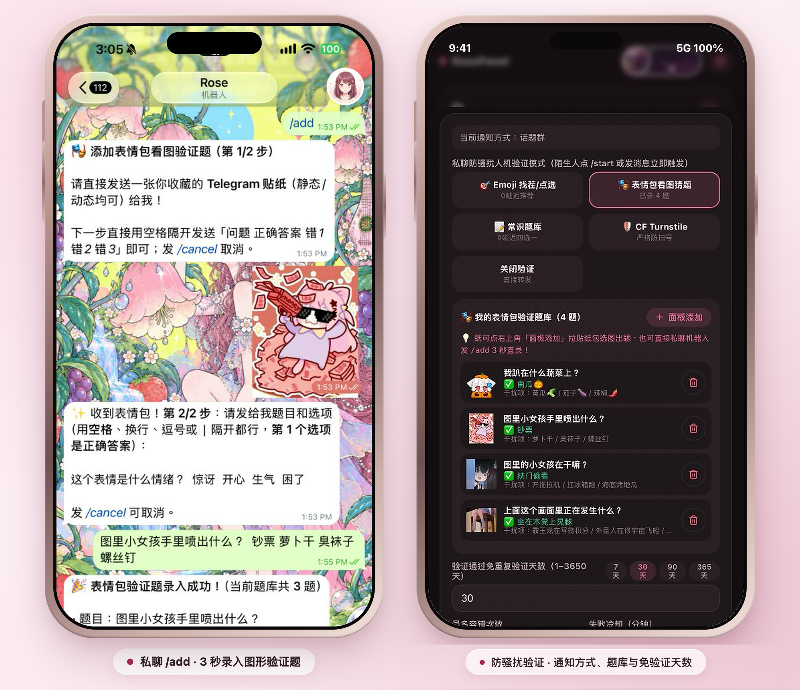
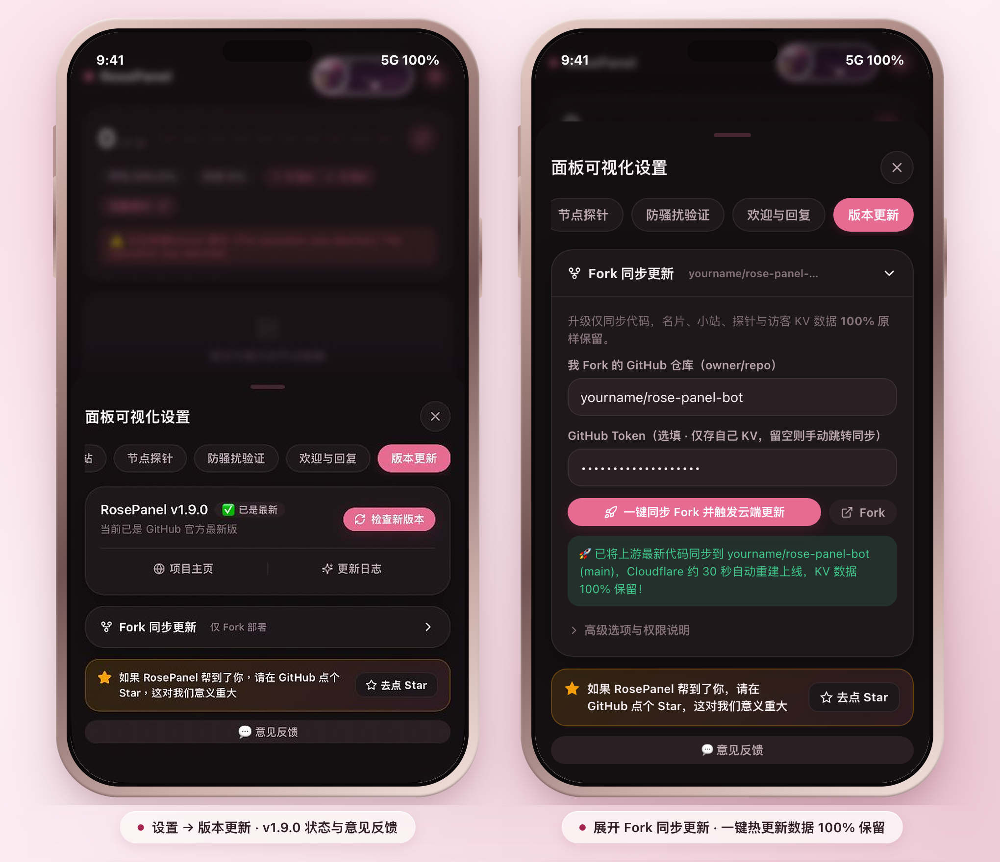
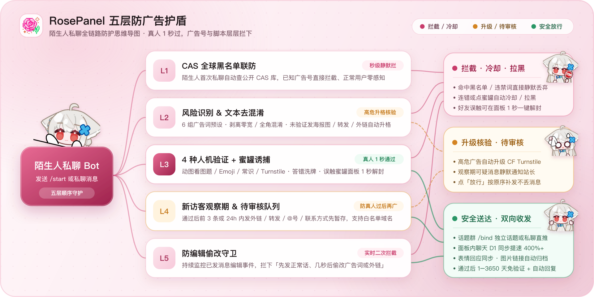

<div align="center">


<br />

[](https://github.com/mango0114/rose-panel-bot/releases)
[](https://github.com/mango0114/rose-panel-bot/stargazers)
[](https://t.me/Rose202_bot)
[](https://workers.cloudflare.com/)
[](https://core.telegram.org/bots/webapps)
[](LICENSE)

<p>
  <a href="README.md">🇨🇳 简体中文</a> ·
  <b>🇭🇰 繁體中文</b> ·
  <a href="README_EN.md">🇺🇸 English</a> ·
  <a href="docs/SETUP_GUIDE_ZH_TW.md">🐣 零基礎 5 分鐘教學</a> ·
  <a href="AGENTS.md">🤖 AI 一鍵部署協議</a> ·
  <a href="CHANGELOG.md">📋 更新日誌</a> ·
  <a href="https://t.me/Rose202_bot">💬 線上體驗 / 聯繫作者</a> ·
  <a href="#-贊助與支持">🧧 贊助支持</a>
</p>

<p>
  <a href="https://deploy.workers.cloudflare.com/?url=https://github.com/mango0114/rose-panel-bot">
    
  </a>
</p>

<sub><b>在面板裡直接聊天、傳圖的防廣告 Telegram 私訊機器人</b> — 接入 Cloudflare D1 面板聊天提速 400%+ · 面板內看紀錄、打字/傳圖回覆與收回 · 五層防護 + 4 種人機驗證（含動圖題）· 免會員自訂回覆 · 附帶 <b>0.2 秒啟動個人面板</b>（多協定探針模組 / 網站書籤），Cloudflare Workers 免費部署</sub>

</div>

> **🔒 零資料收集承諾**：本專案 **不收集任何使用者資料、不經過作者或任何第三方中轉伺服器**；所有 Bot Token、設定、小站與訪客紀錄全部儲存在**你自己的 Cloudflare Workers 與 KV** 中，程式碼 100% 開源可審計（除 Telegram 官方 Bot API 外，僅在對應功能開啟時請求公開唯讀的 CAS 黑名單、CF Turnstile 校驗，以及站長開啟設定時向 GitHub 公開介面檢查新版本）。

> **🧭 快速上手分流（老手 / 新手各走各的，不繞路！）**：
> - **⚡ 老手（已有 TG 機器人 Token + Cloudflare 帳號）**：直接點上方 **Deploy to Cloudflare**，或把倉庫交給 AI（準備好 `BOT_TOKEN`，等 AI 問你要時貼給它）→ **[查看 1 分鐘老手速通](docs/SETUP_GUIDE_ZH_TW.md#-老手速通通道已有-bot-token--cloudflare)**
> - **🐣 新手（還沒有機器人 或 還沒有 Cloudflare 帳號）**：AI 無法代你申請機器人，先花 30 秒到 TG 找 `@BotFather` 拿到 Token → **[零基礎 5 分鐘保姆教學（含全景流程圖）](docs/SETUP_GUIDE_ZH_TW.md#-新手零基礎通道還沒有機器人或-cloudflare)**
> - **🤖 AI 懶人部署提示詞**（支援 Antigravity / Claude Code / Codex / Cursor，內建 [AGENTS.md](AGENTS.md)）：
>   ```text
>   請閱讀倉庫裡的 AGENTS.md，先詢問我需要開啟哪些模組（或選擇輕量化安裝），再幫我一步步部署 RosePanel Bot。
>   ```

---

## ✨ 5 秒看懂 RosePanel 的 5 個特色

| 核心特色 | 一句話看懂 |
| :--- | :--- |
| **💬 面板內直接聊天傳圖** | 點「💬 聊過」看 60 條紀錄，直接打字 / 手機相簿傳圖 / 雙向收回，靜默同步管理群主題 |
| **🎭 收藏動圖出驗證題** | 私訊 `/add` 3 秒用靜/動圖出題，**答錯換題洗牌** + 防腳本蜜罐 + CAS 黑名單聯防 |
| **🎨 0.2 秒面板 + 像素滑塊** | 原創 **224×84 像素晝夜氣泡滑塊**（圓形波紋切暗黑）+ `/set` 動態貼圖徽章 + 隱私頭像代理 |
| **📡 模組化按需選配** | Komari / 哪吒（v1·v0）/ NodeGet / JSON 探針 + 公開/私密雙層小站，不裝零負擔 |
| **🔒 零中轉 + Fork 一鍵更新** | 運行在你自己的 Cloudflare Workers 免費額度；新版站內提醒，Fork 一鍵同步且資料 100% 保留 |

---

## 🎬 動態功能展示（三段實機錄影）

### 1 · 面板內直接聊天與相簿選圖傳圖

<div align="center">
  
</div>

- 點開任意訪客資料卡的 **「💬 聊過」** 即可查看最近 60 條雙向對話氣泡，**直接在 Mini App 內打字、從手機相簿任意選圖（JPG / PNG / WebP / GIF，單張 ≤ 10 MB）傳送，並支援一鍵雙向收回**；
- 傳出的圖文會自動靜默抄送至管理群對應主題，兩邊隨時無縫接力，往來圖片與連結按「對方發來 / 我發出的」自動分類歸檔。

### 2 · 陌生人首次 `/start` 貼圖雙題驗證（答錯自動換新題）

<div align="center">
  
</div>

- 陌生人點「開始」傳 `/start` 立即觸發人機驗證：私訊傳 `/add` 三秒即可用你收藏的**靜態 / 動態貼圖**出專屬趣味看圖題；
- **答錯就洗牌**：題庫有多道題時立刻換另一張貼圖出題（單題則重新隨機打亂按鈕位置），題底附帶防腳本蜜罐陷阱；通過後 30 天內免驗證直通私訊，並可觸發**免會員自動回覆與關鍵字秒回**。

### 3 · 0.2 秒啟動個人面板 & 224×84 像素晝夜氣泡滑塊

<div align="center">
  
</div>

- 往來圖片相簿支援按發送方一鍵篩選；內建 **Komari / 哪吒（v1 / v0）/ NodeGet / 通用 JSON** 多協定可插拔探針與 **公開 / 🔒 僅我可見** 雙層個人小站；
- **全新 224×84 像素晝夜氣泡滑塊**：頂欄水晶放大鏡滑塊可自由拖動切換 **淺色 / 跟隨 Telegram / 暗黑玫瑰瓷**，放手以圓形波紋平滑切換全螢幕深淺主題，並同步 Telegram 原生頂欄配色。

---

## 💬 更多主打亮點：`/add` 出題 · `/set` 動態徽章 · Fork 一鍵同步更新

<div align="center">
  <p><b>🎭 私訊 <code>/add</code> 三秒收錄貼圖驗證題 · 陌生人點 Start 即驗直通私訊</b></p>
  
  <br /><br />
  <p><b>✨ 私訊 <code>/set</code> 秒換動態貼圖主徽章 · 收藏徽章庫與 0 秒開屏同步</b></p>
  
  <br /><br />
  <p><b>🔄 Fork 部署 · 新版站內提醒 · 一鍵同步更新（資料 100% 保留）</b></p>
  
</div>

<details>
<summary><b>📱 展開查看四大選單靜態超清實機畫廊（名片 · 小站 · 探針 · 暗黑主題）</b></summary>

<br />
<div align="center">
  <p><b>🪪 1 · 玫瑰瓷個人名片與一鍵發私訊　｜　🌐 2 · 公開 / 私密雙層個人小站</b></p>
  
  <br /><br />
  <p><b>📡 3 · 多合一節點探針（Komari / 哪吒 / NodeGet / JSON）　｜　🛡️ 4 · 五層防廣告護盾與訪客列表</b></p>
  
  <br /><br />
  <p><b>🌙 暗黑玫瑰瓷主題　｜　🖼️ 往來圖片相簿與連結清單（按「對方發來 / 我發出的」自動歸檔）</b></p>
  
</div>
</details>

---

## ✨ 核心功能一覽

- **💬 面板內直接打字 / 傳圖聊天 + 往來圖片與連結歸檔 + 群內 `/bind` 收件匣**
  - **Mini App 內直接聊天**：點開任意訪客資料卡的 **「💬 聊過」** 即可查看最近 60 條雙向對話氣泡，支援**直接在面板內打字、從相簿選圖傳送、一鍵撤回訊息**，所有回覆會自動靜默抄送至通知群對應主題，兩邊隨時無縫接力；
  - **往來媒體自動歸檔 & 一鍵綁群**：雙方傳送的圖片（HMAC 簽章私密代理 + 燈箱）與網址連結自動按「對方發來 / 我發出的」分類歸檔；私密主題群傳一句 **`/bind`** 即可完成綁定（免查 `-100...` 群組 ID），支援主題內 `/del` 撤回私訊、備註、封鎖/一鍵解封/永久信任與清空紀錄。
- **🎭 一鍵傳送靜 / 動態貼圖，快捷設定圖形驗證題**
  - 私訊機器人傳 `/add` 再直接丟一張你收藏的靜態/動態貼圖 + 空格輸入選項，3 秒產生專屬看圖選擇題；也支援在 Mini App 內載入貼圖包直接點選出題，真人一眼秒過，大幅提高自動化廣告腳本的繞過成本。
- **🛡️ 五層智慧防廣告護盾（毫秒級零卡頓）**
  1. **第 1 層 · CAS 全球反垃圾黑名單聯防**：陌生人首次聯繫查詢公開 CAS 庫（KV 快取），**真人 0 感知秒過**，已知廣告協議號直接靜默攔截；
  2. **第 2 層 · 攔截廣告海報圖 + 高危自動升級**：未驗證前直接甩 USDT/賭場/機場純圖海報、頻道轉發或外部連結時拒收暫存，並自動升級至 Cloudflare Turnstile 嚴格核驗；
  3. **第 3 層 · 0 延遲圖形/Emoji 驗證 + 防腳本蜜罐**：支援貼圖看圖驗證、Emoji 找碴、常識題庫與 CF Turnstile 四檔切換；題底可埋設防腳本陷阱按鈕（預設觸發驗證冷卻防真人誤觸永久失聯，亦可切為直接封鎖），連錯自動進入冷卻；
  4. **第 4 層 · 去混淆關鍵字封鎖 + 編輯偷改監聽**：自動去除零寬/全形/西里爾同形字混淆，並監聽 `edited_message` 攔截「先傳正常話、幾秒後偷改成廣告」的繞過。
- **⚡ 附送 0.2 秒啟動個人面板 Mini App、像素晝夜滑塊 & 動態貼圖徽章**
  - Worker 邊緣 HTML 注入開屏設定（支援 **徽章呼吸 / 表情跳動 / 卡片骨架屏** 3 種風格）+ 前端本地秒開快取 + 站長概覽單鍵快取（KV 消耗降 50 倍）；頂欄內建原創 **224×84 像素晝夜氣泡滑塊**（淺色 / 跟隨 Telegram / 暗黑玫瑰瓷三檔自由拖動 + 圓形波紋切換），並同步 Telegram 原生頂欄配色；
  - 私訊傳 `/set` 直接傳靜態 `.webp` / 動態影片 `.webm` / 60fps 向量 `.tgs` 貼圖或自訂表情，秒換名片主徽章並自動存入收藏徽章庫；名片頭像支援 **🤖 機器人頭像（預設隱藏主號）/ 👤 站長 TG 頭像隱匿代理 / 🖼️ 自訂直連** 3 選 1，右側票根文案支援自由編輯與留空隱藏；
  - 站長首屏底部附帶 **僅自己可見的「站長速覽」**（已攔截廣告數、活躍訪客數、最近聯繫快捷直達），升級新版自動彈出 **「✨ 近期更新」** 變更摘要，內建 **「版本更新」檢查新版本與一鍵同步 Fork 並觸發雲端更新**，並支援一鍵開啟 **群組簽到積分與徽章系統**。
- **🌐 公開 / 私密雙層個人小站 & 📡 多協定節點探針（按需安裝）**
  - 小站支援分類、搜尋、排序與單筆一鍵切換 **「公開 / 🔒 僅我可見」**（私密站點伺服器端嚴格剔除，訪客不可見）；
  - 探針採可插拔架構，內建 **Komari (v2/v1)**、**哪吒探針 (v1 公開 WS / v1 REST / v0)**、**NodeGet (NodeSeek 官方探針)** 與 **通用 JSON 探針**（極簡/CF/ServerStatus 等），內建「測試探針連線」、重新導向循環保護、15 秒邊緣快取與 **「僅自己可見」** 隱私開關。
- **🤖 絲滑進門引導、免會員自動回覆 & 關鍵字秒回**
  - **進門即驗 · 直通私訊**：儲存歡迎語自動同步至 Telegram 未點開始前的頂部介紹框；陌生人點 `/start`（或在名片點「發私訊」）直接彈出人機驗證，通過後即可直接打字留言；支援自由調節免驗證天數（1–3650 天）與一鍵顯隱左下角「個人面板」選單按鈕（免重跑 `/setup`）；
  - **收到訊息自動回覆 & 關鍵字秒回（最多 50 條）**：自訂忙碌回執 + 單訪客冷卻防洗版；關鍵字支援包含/精確比對與「轉發站長 / 靜默直回」，嚴格在驗證通過後觸發。

---

##  五層防騷擾與人機驗證架構

<div align="center">
  
</div>

內建 **4 種人機驗證方式**，可在 Mini App **⚙️ 設定 → 防騷擾驗證** 一鍵切換：

| 驗證模式 | 原理與體驗 | 防刷與防繞過 |
| :--- | :--- | :--- |
| **🎭 貼圖看圖猜題（私房推薦）** | 私訊傳 `/add`（或在面板貼圖包內點選）收錄你收藏的動圖/靜圖貼圖與自訂趣味選項，**真人一眼秒過、大幅提高自動化協議號繞過成本** | 答錯就洗牌：題庫有多道題時換另一張貼圖出題，只有一道題時正確答案與干擾項重新打亂順序；通過後自動清理貼圖 + 蜜罐陷阱與靜默冷卻 |
| **🎯 Emoji 找碴 / 點選（預設）** | 3×3 純圖示按鈕隨機交替出題（8 同 1 異找碴或中文提示點選），**0 延遲、真人 0.5 秒通過** | 錯 1 次立刻換題打亂，連錯 2 次靜默冷卻 10 分鐘（次數與時長可調） |
| **📝 常識題庫** | 本地 2×2 常識問答按鈕，零外部依賴 | 錯 1 次換題並重新打亂選項 + 蜜罐 + 靜默冷卻 |
| **🛡️ CF Turnstile 嚴格模式** | 遇到定向掃號攻擊時一鍵開啟，在 Telegram 內嵌 WebApp 完成 Cloudflare 伺服器端 `siteverify` 核驗 | 未配金鑰時自動回退至 Emoji 模式防卡死 |

- **🔀 答錯就洗牌（防背答案）**：三種按鈕驗證（貼圖看圖猜題 / Emoji 找碴 / 常識題庫）答錯一次就立刻換新題，正確答案與干擾項每次都重新打亂順序。**即使抽到的還是同一道題，正確答案的按鈕位置也會重新隨機**，腳本無法靠「記住第幾個按鈕」穩定矇混過關；連錯達到上限（預設 2 次）即靜默冷卻。

- **資料與權限安全**：Mini App 介面全量校驗 Telegram 官方 `initData` HMAC-SHA256 簽章；站長概覽採用單鍵快取與記憶體 `<0.1ms` 極速鑑權，日常開啟僅需 2 次 KV 讀取、0 次 `KV.list`；`BOT_TOKEN` 絕不暴露前端。

---

## 🧩 模組化按需選配 & 🤖 AI 引導安裝

未啟用的模組零負擔、不干擾介面；倉庫根目錄內建標準 **[AGENTS.md](AGENTS.md)**，用 AI 程式助手安裝時 AI 會先詢問你需要哪些模組：

| 模組 | 預設狀態 | 開啟條件 | 說明 |
| :--- | :---: | :--- | :--- |
| **🪪 個人名片 + 🌐 公開/私密小站** | 核心必選 | `BOT_TOKEN` + `TOPIC_MAP` KV | 極簡運行即可擁有玫瑰瓷個人面板、動態貼圖徽章與雙層小站 |
| **📡 多協定節點探針** | 按需選配 | Mini App 內選類型並填網址 | 支援 **Komari / 哪吒 (v1/v0) / NodeGet / 通用 JSON**，未填或設為「僅自己可見」時對訪客隱藏 |
| **👤 雙向私訊 + 五層反廣告護盾** | 按需選配 | 主題群內傳 `/bind`（或填 `SUPERGROUP_ID`） | 主題收件匣、往來圖片相簿、連結歸檔、CAS、貼圖驗證與觀察期審核 |
| **🛡️ CF Turnstile 嚴格驗證** | 按需選配 | 填入 `TURNSTILE_SITE_KEY` & `SECRET` | 高危廣告自動升級核驗，或在設定裡手動切換 |
| **🌸 群組簽到積分與徽章系統** | 按需選配 | `ENABLE_CHECKIN="true"` 或設定內一鍵開 | 個人名片模式預設關閉，群組社群部署時一鍵開啟 |

> **🤖 AI 一鍵選配部署（Antigravity / Claude Code / Codex / Cursor 通用）**：開啟本倉庫對 AI 說：
> ```text
> 請閱讀倉庫裡的 AGENTS.md，先詢問我需要開啟哪些模組（或選擇輕量化安裝），再幫我一步步部署 RosePanel Bot。
> ```

---

## 🚀 極簡部署（5 分鐘免費上線）

> **🐣 第一次申請 Telegram 機器人？** 請直接跟著 **[零基礎 5 分鐘保姆教學](docs/SETUP_GUIDE_ZH_TW.md)** 一步步操作，從 `@BotFather` 拿到第一個 Token 到群內 `/bind` 上線零門檻！

### 方式一：網頁零環境部署（最省心 ★，免裝本機環境）

1. **推薦先點擊右上角 Fork** 再到 Cloudflare Dashboard → **Workers & Pages → Create → Workers → Import a repository** 選擇你 Fork 的 `rose-panel-bot`（之後永久支援 `Sync fork` 與面板站內一鍵更新）；也可直接點頂部 **Deploy to Cloudflare** 按鈕快速體驗：
   - **Build command**：`npm run build`
   - **Deploy command**：`npx wrangler deploy`
2. 在 Worker 的 **Settings → Variables & Bindings** 確認綁定了 `TOPIC_MAP` KV，並填入 4 個核心變數：`BOT_TOKEN`（Secret）、`WEBHOOK_SECRET`（Secret）、`ADMIN_IDS`（**務必選 Text 純文字變數**，填你的純數字 UID；若一鍵部署預設建成了 Secret 金鑰請刪掉重加為 Text）、`BOT_USERNAME`（不含 `@`）。
3. 瀏覽器開啟一次 `https://<你的網域>/setup?secret=<WEBHOOK_SECRET>` 看到 `"ok": true`。
4. *(如需雙向私訊)* 新建開啟 **「主題 (Topics)」** 的私密群組、將機器人設為管理員，在群裡傳一句 **`/bind`** 即可完成全部設定！

### 方式二：開發者終端 4 步速通（macOS / Linux / Windows，全程免點網頁）

```bash
# 1. 下載程式碼並安裝依賴（需 Node.js 20+）
git clone https://github.com/mango0114/rose-panel-bot.git && cd rose-panel-bot && npm ci

# 2. 登入 Cloudflare 並建置部署（Wrangler v4 會自動建立 TOPIC_MAP KV）
#    把下方替換為你的純數字 TG UID 與機器人使用者名稱（不含 @）
npx wrangler login
npm run build && npx wrangler deploy --var ADMIN_IDS:你的數字UID --var BOT_USERNAME:你的Bot使用者名稱

# 3. 寫入兩個核心 Secret（依提示貼上即可）
npx wrangler secret put BOT_TOKEN
npx wrangler secret put WEBHOOK_SECRET

# 4. 啟動 Webhook 與選單（看到 {"ok":true,...} 即上線）
curl -s "https://<你的Worker網域>/setup?secret=<你的WEBHOOK_SECRET>"
```

> *(如需雙向私訊)* 新建開啟 **「主題 (Topics)」** 的私密群組、將機器人設為管理員，在群裡傳一句 **`/bind`** 即可完成綁定。

<details>
<summary><b>🛠️ 環境安裝（Windows / macOS）與 Linux VPS / Docker / 純自託管</b></summary>

- **Windows 安裝 Git & Node**：`winget install --id Git.Git -e && winget install --id OpenJS.NodeJS.LTS -e`
- **macOS 安裝 Git & Node**：`brew install git node`
- **Linux 安裝 Git & Node 22**：
  - Debian / Ubuntu：`sudo apt update && sudo apt install -y curl git ca-certificates && curl -fsSL https://deb.nodesource.com/setup_22.x | sudo -E bash - && sudo apt install -y nodejs`
  - CentOS / Rocky / Alma：`sudo dnf install -y curl git && curl -fsSL https://rpm.nodesource.com/setup_22.x | sudo bash - && sudo dnf install -y nodejs`
  - Arch：`sudo pacman -Syu --noconfirm git nodejs npm` ｜ Alpine：`apk add --no-cache git nodejs npm`

#### 無瀏覽器 VPS 推送至 Cloudflare Workers
```bash
git clone https://github.com/mango0114/rose-panel-bot.git && cd rose-panel-bot && npm ci
export CLOUDFLARE_API_TOKEN="你的_Cloudflare_API_Token"
npm run build && npx wrangler deploy --var ADMIN_IDS:你的數字UID --var BOT_USERNAME:你的Bot使用者名稱
echo "你的_BOT_TOKEN" | npx wrangler secret put BOT_TOKEN
echo "你的隨機_WEBHOOK_SECRET" | npx wrangler secret put WEBHOOK_SECRET
curl -s "https://<你的Worker網域>/setup?secret=<你的WEBHOOK_SECRET>"
```

#### Docker 一行部署（不污染宿主機）
```bash
git clone https://github.com/mango0114/rose-panel-bot.git && cd rose-panel-bot
docker run --rm -it -v "$PWD":/app -w /app -e CLOUDFLARE_API_TOKEN="你的_API_Token" node:22-alpine \
  sh -c "npm ci && npm run build && npx wrangler deploy --var ADMIN_IDS:你的數字UID --var BOT_USERNAME:你的Bot使用者名稱"
```

#### 4. 純 VPS 自託管（搭配 Caddy 自動 HTTPS）
```bash
npm ci && npm run build && cp .dev.vars.example .dev.vars
# 編輯 .dev.vars 填入真實變數（DEV_PREVIEW 僅在 localhost 生效，正式環境保持 "false"）
npx wrangler dev --ip 127.0.0.1 --port 8787 --persist-to ./.wrangler/state --show-interactive-dev-session=false
```
再用 Caddy 反向代理 `reverse_proxy 127.0.0.1:8787` 綁定 HTTPS 網域即可。
</details>

---

## 🔄 舊用戶如何升級到最新版（100% 保留 KV 資料）

> **✅ 無需修改 Cloudflare KV！** 升級只更新程式碼，你原有的名片、小站、探針、訪客紀錄與通知群綁定都會 **100% 原樣保留**（⚠️ 請勿重新點擊「Deploy to Cloudflare」按鈕，那會新建一個空的 Worker 和 KV）。

- **🔀 方式 A · GitHub Fork 用戶（最簡單）**  
  到你的 GitHub Fork 倉庫點擊 **`Sync fork → Update branch`**（升至 `v1.4.0+` 後也可在面板 **⚙️ 設定 → 版本更新** 內一鍵同步），Cloudflare 約 30 秒自動完成重建上線。
- **🤖 方式 B · 直接交給 AI 一鍵更新（適合一鍵按鈕獨立副本 / AI 部署用戶）**  
  把下面這段話傳給你的 AI 助手（Antigravity / Claude Code / Codex / Cursor 等）：
  ```text
  請閱讀 https://github.com/mango0114/rose-panel-bot 的 AGENTS.md，幫我把之前部署的 RosePanel Bot 升級到最新版：把上游最新程式碼合併進我自己的 GitHub 倉庫並推送，讓 Cloudflare 自動重建。不要新建 Worker、KV 或 Bot；如果必須用 wrangler 部署，先確認 Worker 名稱和 wrangler.toml 裡的 KV ID 與我原來的一致並用 --keep-vars。
  ```
- **💻 方式 C · 本機 CLI 部署用戶**  
  在專案目錄執行：`git pull && npm install && npm run build && npx wrangler deploy --keep-vars`。

---

## ⚙️ 環境變數一覽

| 變數名 | 類型 | 必填 | 說明 |
| :--- | :--- | :---: | :--- |
| `TOPIC_MAP` | KV Binding | ✅ | 持久化面板設定、小站、訪客與媒體歸檔、簽到資料 |
| `BOT_TOKEN` | Secret | ✅ | `@BotFather` 核發的 Telegram Bot Token |
| `ADMIN_IDS` | Text | ✅ | 站長數字 UID，多個用英文逗號分隔（設定後 `<0.1ms` 記憶體極速鑑權，0 KV 寫入） |
| `WEBHOOK_SECRET` | Secret | ✅ | 隨機密鑰，保護 Webhook（含 `/` 與 `/webhook`）與 `/setup`（未設定時 `/setup` 拒絕執行） |
| `BOT_USERNAME` | Text | 推薦 | 機器人使用者名稱（不含 `@`） |
| `APP_SHORT_NAME` | Text | 推薦 | BotFather `/newapp` 設定的 Mini App 短名（如 `panel`） |
| `SUPERGROUP_ID` | Text | 可選 | 主題通知群 ID（**推薦部署後直接在群內傳 `/bind` 一鍵綁定，免手填**） |
| `TURNSTILE_SITE_KEY` / `TURNSTILE_SECRET` | Text / Secret | 可選 | 開啟 CF Turnstile 嚴格驗證模式時填寫 |
| `PROBE_PROVIDER` | Text | 可選 | 探針類型：`komari`（預設）/ `nezha` / `nodeget` / `json`（極簡、CF 等通用 JSON 探針） |
| `PROBE_URL` / `PROBE_API_KEY` | Text / Secret | 可選 | 探針網址與私有憑證（舊名 `KOMARI_URL` / `KOMARI_API_KEY` 仍相容，也可在面板內填寫並測試連線） |

---

## 🤖 常用指令

- **通用**：`/start` · `/panel` · `/me` · `/checkin`（群組社群模式）· `/rank`（群組社群模式）
- **站長私訊**：`/set`（秒設動態貼圖主徽章）· `/add`（收錄收藏貼圖看圖驗證題）· `/resetbadge` · `/cancel`
- **通知群主題內**：`/bind`（一鍵綁定通知群）· `/unbind`（解綁）· `/del`（回覆訊息撤回私訊）· `/info` · `/ban` · `/unban` · `/trust` · `/reset` · `/close` · `/open`

---

## 🙏 致謝與技術棧

- 協議適配與相容：[Komari Monitor](https://github.com/komari-monitor/komari) · [Combot Anti-Spam (CAS)](https://cas.chat/) · [jikssha/telegram_private_chatbot](https://github.com/jikssha/telegram_private_chatbot)
- 開源基礎設施：[Cloudflare Workers](https://workers.cloudflare.com/) · [Telegram Mini Apps](https://core.telegram.org/bots/webapps) · [React](https://react.dev/) · [Vite](https://vitejs.dev/) · [Lucide Icons](https://lucide.dev/) · [lottie-web](https://github.com/airbnb/lottie-web)

---

## 🧧 贊助與支持

本專案以 MIT 協議完全免費開源，所有核心功能零付費牆、零資料收集。如果你喜歡 **RosePanel Bot**，或者它幫你擋掉了惱人的 TG 廣告騷擾，歡迎請作者喝杯咖啡 / 投餵一點 AI 算力，支持專案持續迭代更強的功能 ☕✨

- **線上體驗 & 聯繫作者**：👉 **[@Rose202_bot](https://t.me/Rose202_bot)**（可親手體驗 0.2 秒啟動個人面板與貼圖看圖驗證）
- **支付寶口令紅包贊助（保護雙方隱私）**：
  1. 在支付寶產生一個任意金額的 **「口令紅包」**；
  2. 私訊 **[@Rose202_bot](https://t.me/Rose202_bot)** 通過驗證後，傳送 **口令 + 你想顯示在名單中的暱稱與留言**（支援匿名）；
  3. 收到後會第一時間將你的支持紀錄到下方贊助者名單中！

### 🏆 贊助者名單

感謝以下支持者的慷慨贊助，您的支持是我們持續改進的動力！

<details open>
<summary><b>展開查看完整贊助者名單（虛位以待 🌸）</b></summary>

| 序號 | 贊助者 | 金額 | 留言 |
| :---: | :---: | :---: | :--- |
| 1 | *虛位以待* | — | 成為第一位支持者，點亮開源贊助牆 ✨ |

</details>

---

## 🌟 Star History

<a href="https://www.star-history.com/#mango0114/rose-panel-bot&Date">
 <picture>
   <source media="(prefers-color-scheme: dark)" srcset="https://api.star-history.com/svg?repos=mango0114/rose-panel-bot&type=Date&theme=dark" />
   <source media="(prefers-color-scheme: light)" srcset="https://api.star-history.com/svg?repos=mango0114/rose-panel-bot&type=Date" />
   
 </picture>
</a>

---

<div align="center">
  <br />
  <b>⭐ 如果這個專案對您有幫助，請給顆 Star 支持一下！</b><br /><br />
  <sub>MIT License © 2026 <a href="https://github.com/mango0114">mango0114</a></sub>
</div>
