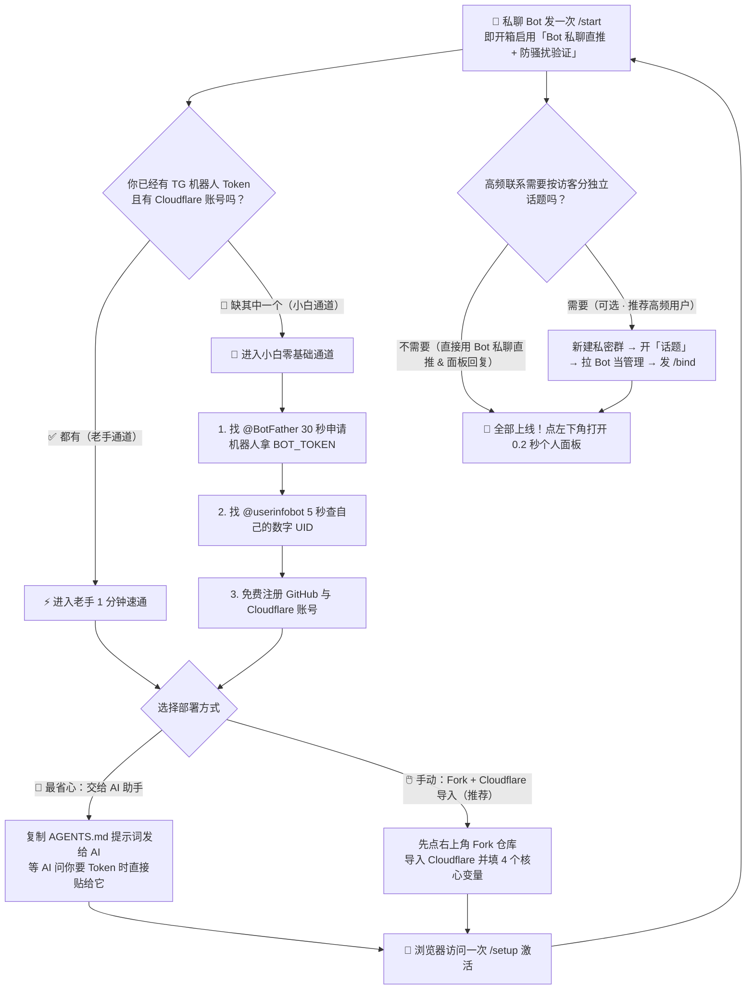

# 🧭 上手部署指南（老手速通 / 小白零基础双通道）

> 🌐 [🏠 返回主页](../README.md) · [🇺🇸 English README](../README_EN.md)

无论你是玩过 Cloudflare 的老手，还是第一次接触 Telegram 机器人的纯小白，都可以 **0 成本（Cloudflare 免费版）** 跑起自己的 **在面板里直接聊天、发图的四层防广告私聊机器人 + 0.2 秒启动个人面板**。

> **💡 给准备用 AI 部署的朋友一句提醒**：AI 无法替你登录个人 Telegram 账号申请机器人。  
> - **已有机器人**：先把下面 4 样准备好，直接把项目丢给 AI，等它问你要时贴给它即可；  
> - **还没有机器人**：先花 30 秒找 `@BotFather` 拿到 `BOT_TOKEN`，再直接交给 AI！

---

## 🎒 动手前：1 分钟先备齐这 4 样（其他全部自动建好）

先把下面 4 个值记在备忘录里，后面照抄粘贴即可，**不需要手动建 KV 或 D1 数据库**：

| 要准备的东西 | Cloudflare 变量类型 | 从哪里拿（1 分钟备齐） | ⚠️ 避坑重点 |
| :--- | :---: | :--- | :--- |
| **`BOT_TOKEN`** | **Secret（加密）** | TG 搜索官方蓝标 **[@BotFather](https://t.me/BotFather)** → 发 `/newbot` 按提示建机器人拿到（已有发 `/mybots → API Token`） | **切勿发到公开群或提交到 GitHub** |
| **`BOT_USERNAME`** | **Text（文本）** | 刚在 `@BotFather` 给机器人起的英文用户名（以 `bot` 结尾，如 `my_rose_bot`） | **不要带开头的 `@`** |
| **`ADMIN_IDS`** | **Text（文本）** | TG 搜索 **[@userinfobot](https://t.me/userinfobot)**（或 [@RawDataBot](https://t.me/RawDataBot)）点 **Start**，复制 `Id:` 后的**纯数字** | 是**你本人**的数字 ID，不是 Bot ID；**务必选 Text 不要选 Secret**，否则面板看不到 ⚙️ 设置 |
| **`WEBHOOK_SECRET`** | **Secret（加密）** | **不用去任何后台找！自己随手编一串密码即可**（如 `rose2026pass`） | 仅用**字母、数字、`-`、`_`**（勿含空格或 `& ? #`），最后访问 `/setup` 激活要用到 |

---

## 🗺️ 全景部署流程图（先看你是哪一类）



**快捷直达：**
- 👉 **[⚡ 老手速通通道（已有 Bot Token + Cloudflare）](#-老手速通通道已有-bot-token--cloudflare)**
- 👉 **[🐣 小白零基础通道（还没有机器人或还没注册 Cloudflare）](#-小白零基础通道还没有机器人或-cloudflare)**
- 👉 **[✨ 上线后 30 秒玩转核心亮点](#-上线后-30-秒玩转核心亮点)**
- 👉 **[❓ 常见问题排错 (FAQ)](#-常见问题排错-faq)**

---

## ⚡ 老手速通通道（已有 Bot Token + Cloudflare）

如果你已经手握 `BOT_TOKEN` 且有 Cloudflare 账号，**1～2 分钟就能上线**，两种方式任选：

### 方案 A · 🤖 丢给 AI 助手全自动部署（推荐）
把本仓库交给 **Antigravity / Claude Code / Codex / Cursor**，直接发下面这段话，**等 AI 问你要 `BOT_TOKEN` 和 `ADMIN_IDS` 时直接发给它**即可：
```text
请阅读仓库里的 AGENTS.md，先询问我需要开启哪些模块（或选择轻量化安装），再帮我一步步部署 RosePanel Bot。
```

### 方案 B · 🖱️ Fork + Cloudflare 网页导入（最推荐，4 步上线，支持面板内一键更新）
1. **先 Fork**：在 [仓库主页](https://github.com/mango0114/rose-panel-bot) 点右上角 **Fork** 到自己的 GitHub 账号（**⚠️ 务必先 Fork**，以后才能在面板内一键同步更新）。
2. **导入部署**：打开 Cloudflare Dashboard → **Workers & Pages → Create → Workers → Import a repository**，选刚 Fork 的仓库（Build：`npm run build`，Deploy：`npx wrangler deploy`），点 **Save and Deploy**（自动建好 `TOPIC_MAP` KV 与 `rose-panel-bot` D1）。
3. **填 4 个变量**：进入 Worker **Settings → Variables & Bindings**，按顶部表格填入 `BOT_TOKEN`（Secret）、`WEBHOOK_SECRET`（Secret）、`ADMIN_IDS`（**务必选 Text**）、`BOT_USERNAME`（Text，不含 `@`），保存部署。
4. **访问 `/setup` 激活**：浏览器打开 `https://<你的域名>/setup?secret=<WEBHOOK_SECRET>`，看到 **`"ok": true`** 即 **🎉 正式上线！** 给 Bot 发一次 `/start` 即可免建群收发私信、打开个人面板。
   *(可选：高频用户建开启「话题」的私密群、拉 Bot 当管理员并群内发 `/bind` 自动切话题模式；同账号多实例注意改 `wrangler.toml` 的 `database_name`。)*

> **已有其他 TG 私聊机器人（如 `nfd`、`telegram_private_chatbot`）？**  
> 无需重新申请 Bot 或新建通知群，直接按上方老手通道操作（跳过小白第 1、2 步）：新建一个 Worker（保留旧 Worker 以便随时回退），沿用原 `BOT_TOKEN`、`BOT_USERNAME`、`ADMIN_IDS` 并自设 `WEBHOOK_SECRET`，访问 `/setup` 完成切换后在原话题群发 `/bind` 即可接管；如需切回旧机器人，重新访问旧程序的 `/setup` 即可。  
> *（从 `telegram_private_chatbot` 迁移可将 `TOPIC_MAP` 绑定回原 KV，保留原有黑名单与话题映射。）*

---

## 🐣 小白零基础通道（还没有机器人或 Cloudflare）

> 没写过代码、没申请过机器人？跟着下面 4 步照做，全程点点鼠标，**新手约 10～20 分钟免费上线**（慢慢来不用急）！

### 第 1 步：30 秒申请你的第一个 Telegram 机器人（拿 `BOT_TOKEN`）

1. 在 Telegram 顶部搜索并打开官方机器人 **[@BotFather](https://t.me/BotFather)**（认准蓝色官方认证勾）。
2. 发送 `/newbot`。
3. 依次回复两样东西：
   - **机器人展示昵称**（支持中文，如 `我的私聊小助手`）；
   - **机器人用户名**（必须英文且以 `bot` 结尾，如 `my_rose_panel_bot`，不可与他人重复）。
4. 创建成功后会收到一串形如 `123456789:AAHxxxxxxxxxxxxxxxxxxxxxxxx` 的密钥，这就是 **`BOT_TOKEN`**，先复制保存好（**切勿发到公开群或提交到 GitHub**）。
5. *(可选美化)* 顺手在 `@BotFather` 发 `/setuserpic` 给机器人换个喜欢的头像。

### 第 2 步：5 秒拿到你自己的数字 UID（填 `ADMIN_IDS`）

1. 在 Telegram 搜索 **[@userinfobot](https://t.me/userinfobot)**（或 [@RawDataBot](https://t.me/RawDataBot)），点击 **Start**。
2. 记下回复里 `Id:` 后面的纯数字（如 `1234567890`），这就是你的 **`ADMIN_IDS`**。

### 第 3 步：免费注册 GitHub 与 Cloudflare 并部署

1. 免费注册登录 [GitHub](https://github.com/) 和 [Cloudflare](https://dash.cloudflare.com/)（Cloudflare Workers 免费额度完全够个人永久使用）。
2. **如果你有 AI 助手（最省心）**：现在你已经备齐上面的 4 样了，直接跳回 **[方案 A · 丢给 AI 全自动部署](#方案-a--丢给-ai-助手全自动部署推荐)**，AI 会带你走完剩下全部步骤！
3. **自己动手点网页部署（3 小步）**：
   - **① Fork 仓库**：打开 [RosePanel Bot 仓库主页](https://github.com/mango0114/rose-panel-bot)，点右上角 **Fork** 到自己的 GitHub（**⚠️ 务必先 Fork**，以后才能在面板内一键同步更新）。
   - **② 导入 Cloudflare**：登录 Cloudflare Dashboard → **Workers & Pages → Create → Workers → Import a repository**，选你刚 Fork 的仓库，保持 **Build command** 为 `npm run build`、**Deploy command** 为 `npx wrangler deploy`，点 **Save and Deploy** 等约 30 秒（**首次部署会自动建好 `TOPIC_MAP` KV 和 `rose-panel-bot` D1 数据库，不用自己手动建库**；如果列表里没看到 `DB`，也可随时按页底 [Q4 手动补绑](#d1-storage)，不绑也能照常使用）。
   - **③ 填 4 个变量并保存**：进入 Worker 的 **Settings → Variables & Bindings**，把前面备齐的 4 项填入并点 **Deploy / Save**：
     | 变量名 | 类型 | 填什么 |
     | :--- | :--- | :--- |
     | `BOT_TOKEN` | **Secret (加密)** | 第 1 步从 `@BotFather` 拿到的 Token |
     | `WEBHOOK_SECRET` | **Secret (加密)** | **自己随手编一串密码**（如 `rose2026pass`，**仅用字母、数字、`-`、`_`**） |
     | `ADMIN_IDS` | **Text (变量文本)** | 第 2 步查到的你自己的数字 UID（**⚠️ 务必选 Text 文本，不要选成 Secret，否则右上角看不到 ⚙️ 设置按钮**） |
     | `BOT_USERNAME` | **Text (变量文本)** | 你的机器人用户名（**不要带 `@`**） |
   - *(推荐)* 在 Worker 的 **Settings → Domains & Routes** 绑定自己的域名（如 `panel.yourdomain.com`）。

### 第 4 步：10 秒一键激活（`/setup`）—— 🎉 到这里就部署完成了！

在浏览器里打开一次下面这个网址（换成你的域名和你刚才编的密码）：

```text
https://你的域名/setup?secret=你刚填的WEBHOOK_SECRET
```

看到页面显示 **`"ok": true`**，机器人就正式连上线啦！左下角也会自动出现 **「个人面板」** 小程序入口。

> **🎉 恭喜！到这里你已经全部部署完成了！**  
> 现在回到 Telegram **私聊你的机器人发一次 `/start`**，就能直接收发陌生人私信（自动防广告验证、引用推送直接回复、面板内打字发图、表情回应双向同步）。下面两项都是**完全可选的进阶项**，以后随时有需要再做即可！

### ✨ 进阶可选（随时再做，跳过完全不影响使用）

1. **让名片海报二维码与群内按钮直达小程序（推荐）**：去 `@BotFather` 发 `/newapp` → 选你的机器人 → 填标题简介图标 → Web App URL 填 `https://你的域名/` → 短名填 `panel`（然后把 Cloudflare 环境变量 `APP_SHORT_NAME` 设为 `panel`）。
2. **升级为独立话题收件箱（`/bind` · 适合高频同时聊多位访客）**：
   - 在 Telegram 里**新建一个私密群**（如 `我的通知群`），只拉进你的机器人（全群 2 人）。
   - 点群名称 → **编辑** → 打开 **「话题 (Topics)」**。
   - 把机器人设为 **管理员**，务必勾选 **「管理话题」** 和 **「删除消息」**。
   - 群里发一句 `/bind`，看到回复 **「🎉 私聊通知群绑定成功！」** 即可自动切换（随时 `/unbind` 无缝退回私聊直推）。

---

## ✨ 上线后 30 秒玩转核心亮点

打开你的机器人，点左下角 **「个人面板」** → 右上角 **⚙️ 设置**，所有功能都能在手机上可视化开关与调整：

- **🎭 一键发静/动态贴纸设图形验证题**：私聊发 `/add` → 发一张收藏表情包 → 用空格隔开发 `题目 正确答案 错1 错2 错3`，3 秒做好一道防广告题！
- **✨ 秒换动态贴纸主徽章 & 分享海报**：私聊发 `/set` 换动图徽章；名片页点 **「分享名片」** 一键生成浅/深色二维码海报；在 **⚙️ 设置 → 名片与徽章** 可复制带 `src_` 来源追踪的推广链接，以及按需开启「公开本月访客数」或关闭底部署名。
- **💬 面板内直接聊天、贴纸展示与表情回应同步**：点开任意访客 **「💬 聊过」** 直接打字/相册发图/查看静动态贴纸与一键撤回；访客与站长双边点赞等 Emoji 回应自动双向同步。
- **🌐 管公开/私密小站 & 📡 多协议探针与掉线告警**：在小程序设置里随手增删小站，探针原生支持 **Komari / 哪吒 (v1/v0) / NodeGet / 通用 JSON**，可在 **⚙️ 设置 → 节点探针** 按需开启掉线与 CPU/内存/磁盘超限告警（默认关闭）。
- **🤖 免会员自动回复与防骚扰策略**：在 **⚙️ 设置 → 防骚扰验证** 切换 4 种人机验证模式；在 **⚙️ 设置 → 欢迎与回复** 配置忙碌自动回执、最多 50 条关键词自动回复、开关 `/start` 欢迎卡片或开启「话题资料卡附带对方头像大图」。

---

## ❓ 常见问题排错 (FAQ)

### Q1：打开小程序后，右上角没有 ⚙️ 设置按钮、底部也没有「访客」栏怎么办？
这说明系统把当前账号识别成了**普通访客**，通常是 `ADMIN_IDS` 没有配对，按下面 3 步检查即可解决：
1. 在 Telegram 找 **[@userinfobot](https://t.me/userinfobot)** 获取**你自己个人账号的纯数字 UID**（注意：**不是** `@用户名`，也**不是**机器人的 ID）；
2. 进入 Cloudflare Worker → **Settings → Variables & Bindings** → 检查 **`ADMIN_IDS`**（类型为 **Text / 变量文本**，多个管理员用英文逗号分隔）。**若一键部署时它被默认建成了「密钥 (Secret)」看不到真实内容（或预填了旧示例值 `123456789`），直接删掉改为「Text / 文本」重新填入你自己的纯数字 UID 即可**；
3. 点击 **Deploy / Save** 保存并重新部署后，务必在 **Telegram 内**关闭小程序再重新打开，右上角 ⚙️ 设置与底部「访客」栏就会立刻出现！
*(注：如果没填 `ADMIN_IDS`、打算靠通知群鉴权，请确认已在话题群里发过 `/bind` 并绑定成功。)*

### Q2：我的探针和面板在同一个 Cloudflare 域名下，测试连接报「重定向循环」怎么办？
这是因为该域名在 Cloudflare 的全局 SSL/TLS 为 **Flexible**，Worker 访问同域名子站时会被降级为 HTTP，而源站又强制跳 HTTPS。  
**解决**：Cloudflare 控制台 → 你的域名 → **Rules → Configuration Rules** 新建规则，条件匹配探针域名和面板域名，把 **SSL** 单独改为 **Full** 即可，不影响同域名下其他子站。

### Q3：后续项目发布新版本，怎么更新？KV 里的数据会丢吗？
**KV 数据 100% 原样保留，绝不删除！** 升级只更新代码，原有的名片、小站、探针、访客记录与通知群绑定都会完整保留（⚠️ **请勿重新点击 Deploy to Cloudflare 按钮**，那会新建一个空的 Worker 和 KV）。绑定 D1 数据库（`DB`）后，老访客的聊天记录会在打开时自动无感迁移到 D1（也可在面板 **⚙️ 设置 → 版本更新 → 数据存储** 点「一键迁移」），未绑定 D1 则继续走原有 KV。**⚠️ 若同一 Cloudflare 账号下部署了 2 个及以上实例，升级前请修改各自仓库 `wrangler.toml` 中的 `database_name`（如 `rose-panel-bot-2`）以免共用同一个 D1 库。** 升级到 `v1.9.0+` 后，在面板 **⚙️ 设置** 里点一次「保存全部设置」即可自动补齐 Webhook 订阅、启用表情回应同步。
- **方式 A · 通过 GitHub Fork 部署（最简单）**：
  - 前往你的 GitHub Fork 页面点击 **`Sync fork → Update branch`**（升至 `v1.4.0+` 后也可直接在小程序 **⚙️ 设置 → 版本更新** 内查看红点并一键同步），Cloudflare 约 30 秒自动完成重建上线。
- **方式 B · 直接交给 AI 一键更新（适合一键按钮独立副本 / AI 部署用户）**：
  - 直接对你的 AI 助手（Antigravity / Claude Code / Codex / Cursor）说：
    ```text
    请阅读 https://github.com/mango0114/rose-panel-bot 的 AGENTS.md，帮我把之前部署的 RosePanel Bot 升级到最新版：把上游最新代码合并进我自己的 GitHub 仓库并推送，让 Cloudflare 自动重建。不要新建 Worker、KV 或 Bot；如果必须用 wrangler 部署，先确认 Worker 名称和 wrangler.toml 里的 KV ID 与我原来的一致并用 --keep-vars。
    ```
- **方式 C · 手动处理一键按钮独立副本（没有 `Sync fork` 按钮）**：
  - **推荐（一劳永逸）**：先到 [官方仓库](https://github.com/mango0114/rose-panel-bot) 点一次右上角 **Fork**，再进 Cloudflare Worker → **Settings → Build** 断开旧副本、重新连接到你刚 Fork 出来的仓库，以后即可永久享受 `Sync fork` 与站内一键同步；
  - 或本地 Git 手动同步：
    ```bash
    git clone https://github.com/<你的用户名>/<你的仓库名>.git && cd <你的仓库名>
    git remote add upstream https://github.com/mango0114/rose-panel-bot.git
    git fetch upstream && git merge upstream/main --allow-unrelated-histories && git push origin main
    ```
- **方式 D · 本地 CLI 部署**：执行 `git pull && npm install && npm run build && npx wrangler deploy --keep-vars`（`v1.2.1` 及更早版本若 webhook 仍指向根路径 `/`，升级后请再访问一次 `https://<你的域名>/setup?secret=<WEBHOOK_SECRET>`）。

<a id="d1-storage"></a>
### Q4：设置页显示「KV（未绑定 D1）」，如何手动绑定 Cloudflare D1 数据库？
不绑定 D1 时机器人也能 100% 正常工作（完全走 KV）。如果你收发私信较多、希望省下每日免费 KV 写入额度并保留超过 60 条的完整聊天历史，只需 30 秒即可免费绑定 D1（无需手动建表，程序会自动建表并迁移旧聊天记录）：
1. 登录 Cloudflare Dashboard → 左侧菜单 **Storage & Databases → D1 SQL Database → Create Database**；
2. 数据库名称请填 **`rose-panel-bot`**（与 `wrangler.toml` 中的 `database_name` 保持一致，避免后续自动构建时重复创建新库；若同一账号下部署了多个机器人实例，请同时修改各自仓库 `wrangler.toml` 中的 `database_name` 以区分）；
3. 进入你的 Worker → **Settings → Bindings (Variables & Bindings) → Add → D1 database**：
   - **Variable name（变量名）**：填 **`DB`**（全大写）
   - **D1 database**：选择刚创建的 `rose-panel-bot`，点 **Deploy / Save** 保存；
4. 重新打开小程序 **⚙️ 设置 → 版本更新**，「数据存储」即变为 `D1` 模式，点一次 **「一键迁移」** 即可把已有访客历史搬入 D1（KV 旧数据保留不删）。
