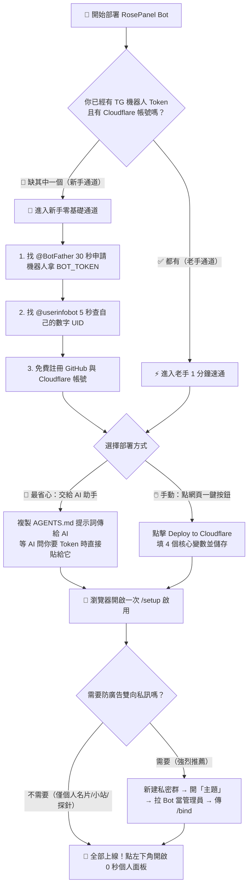

# 🧭 上手部署指南（老手速通 / 零基礎雙通道）

> 🌐 語言切換：[🇨🇳 简体中文教程](SETUP_GUIDE.md) · **🇭🇰🇹🇼 繁體中文教學** · [🏠 返回繁體主頁](../README_ZH_TW.md)

無論你是熟悉 Cloudflare 的老手，還是第一次接觸 Telegram 機器人的純新手，都可以 **0 成本（Cloudflare 免費版）** 跑起自己的 **四層防廣告雙向私訊機器人 + 0 秒啟動個人面板**。

> **💡 給準備用 AI 部署的朋友一句提醒**：AI 無法代你登入個人 Telegram 帳號申請機器人。  
> - **已有機器人**：先把下面 4 樣準備好，直接把專案交給 AI，等它問你要時貼給它即可；  
> - **還沒有機器人**：先花 30 秒到 Telegram 找 `@BotFather` 拿到 `BOT_TOKEN`，再直接交給 AI！

---

## 🎒 動手前：1 分鐘先備齊這 4 樣（其餘全部自動建立）

先把下面 4 個值記在備忘錄裡，後面直接複製貼上即可，**不需要手動建立 KV 或 D1 資料庫**：

| 要準備的東西 | Cloudflare 變數類型 | 從哪裡拿（1 分鐘備齊） | ⚠️ 避坑重點 |
| :--- | :---: | :--- | :--- |
| **`BOT_TOKEN`** | **Secret（加密）** | TG 搜尋官方藍標 **[@BotFather](https://t.me/BotFather)** → 傳 `/newbot` 建立取得（已有機器人傳 `/mybots → API Token`） | **切勿傳到公開群組或提交到 GitHub** |
| **`BOT_USERNAME`** | **Text（純文字）** | 剛在 `@BotFather` 為機器人取的英文使用者名稱（以 `bot` 結尾，如 `my_rose_bot`） | **不要帶開頭的 `@`** |
| **`ADMIN_IDS`** | **Text（純文字）** | TG 搜尋 **[@userinfobot](https://t.me/userinfobot)**（或 [@RawDataBot](https://t.me/RawDataBot)）點 **Start**，複製 `Id:` 後的**純數字** | 是**你本人**的數字 ID，不是 Bot ID；**務必選 Text 不要選 Secret**，否則看不到 ⚙️ 設定 |
| **`WEBHOOK_SECRET`** | **Secret（加密）** | **不用去任何後台找！自己隨手編一串密碼即可**（如 `rose2026pass`） | 僅用**字母、數字、`-`、`_`**（勿含空格或 `& ? #`），最後開啟 `/setup` 啟用會用到 |

---

## 🗺️ 全景部署流程圖（先看你是哪一類）



**快捷直達：**
- 👉 **[⚡ 老手速通通道（已有 Bot Token + Cloudflare）](#-老手速通通道已有-bot-token--cloudflare)**
- 👉 **[🐣 新手零基礎通道（還沒有機器人或 Cloudflare）](#-新手零基礎通道還沒有機器人或-cloudflare)**
- 👉 **[✨ 上線後 30 秒玩轉貼圖驗證與動態徽章](#-上線後-30-秒玩轉貼圖驗證與動態徽章)**
- 👉 **[❓ 常見問題排錯 (FAQ)](#-常見問題排錯-faq)**

---

## ⚡ 老手速通通道（已有 Bot Token + Cloudflare）

如果你已經手握 `BOT_TOKEN` 且有 Cloudflare 帳號，**1～2 分鐘就能上線**，兩種方式任選：

### 方案 A · 🤖 交給 AI 助手全自動部署（推薦）
把本倉庫交給 **Antigravity / Claude Code / Codex / Cursor**，直接傳下面這段話，**等 AI 問你要 `BOT_TOKEN` 和 `ADMIN_IDS` 時直接貼給它**即可：
```text
請閱讀倉庫裡的 AGENTS.md，先詢問我需要開啟哪些模組（或選擇輕量化安裝），再幫我一步步部署 RosePanel Bot。
```

### 方案 B · 🖱️ 一鍵點按鈕手動上線（4 步搞定）
1. 點擊 [](https://deploy.workers.cloudflare.com/?url=https://github.com/mango0114/rose-panel-bot)（Build：`npm run build`，Deploy：`npx wrangler deploy`）。
2. 在 Worker **Settings → Variables & Bindings** 確認綁定了 `TOPIC_MAP` KV，並填入 4 個核心變數：
   - `BOT_TOKEN`（Secret）· `WEBHOOK_SECRET`（Secret，任意隨機字串）· `ADMIN_IDS`（你的數字 UID）· `BOT_USERNAME`（不含 `@`）。
3. 瀏覽器開啟 `https://<你的網域>/setup?secret=<WEBHOOK_SECRET>`，看到 `"ok": true` 即啟用成功。
4. 新建開啟 **「主題 (Topics)」** 的私密群組、把機器人設為管理員（勾選管理主題 & 刪除訊息），群內傳一句 **`/bind`** 秒完成通知群綁定！

---

## 🐣 新手零基礎通道（還沒有機器人或 Cloudflare）

> 沒寫過程式、沒申請過機器人？跟著下面 5 步照做，全程點點滑鼠 **5 分鐘免費上線**！

### 第 1 步：30 秒申請你的第一個 Telegram 機器人（拿 `BOT_TOKEN`）

1. 在 Telegram 頂部搜尋並開啟官方機器人 **[@BotFather](https://t.me/BotFather)**（認準藍色官方認證勾）。
2. 傳送 `/newbot`。
3. 依序回覆兩樣東西：
   - **機器人顯示名稱**（支援中文，如 `我的私訊小助手`）；
   - **機器人使用者名稱**（必須英文且以 `bot` 結尾，如 `my_rose_panel_bot`，不可與他人重複）。
4. 建立成功後會收到一串形如 `123456789:AAHxxxxxxxxxxxxxxxxxxxxxxxx` 的金鑰，這就是 **`BOT_TOKEN`**，先複製保存好（**切勿傳到公開群組或提交到 GitHub**）。
5. *(可選美化)* 順手在 `@BotFather` 傳 `/setuserpic` 幫機器人換個喜歡的頭像。

### 第 2 步：5 秒拿到你自己的數字 UID（填 `ADMIN_IDS`）

1. 在 Telegram 搜尋 **[@userinfobot](https://t.me/userinfobot)**（或 [@RawDataBot](https://t.me/RawDataBot)），點擊 **Start**。
2. 記下回覆裡 `Id:` 後面的純數字（如 `1234567890`），這就是你的 **`ADMIN_IDS`**。

### 第 3 步：免費註冊 GitHub 與 Cloudflare 並部署

1. 免費註冊登入 [GitHub](https://github.com/) 和 [Cloudflare](https://dash.cloudflare.com/)（Cloudflare Workers 免費額度完全夠個人永久使用）。
2. **如果你有 AI 助手（最省心）**：現在你已經拿到 `BOT_TOKEN` 和 `ADMIN_IDS` 了，直接跳回上面的 **[方案 A · 交給 AI 助手全自動部署](#方案-a--交給-ai-助手全自動部署推薦)**，AI 會帶你走完剩下全部步驟！
3. **自己動手點網頁部署**：
   - 點擊一鍵部署按鈕：[](https://deploy.workers.cloudflare.com/?url=https://github.com/mango0114/rose-panel-bot)
   - 建置參數保持預設（Build：`npm run build`，Deploy：`npx wrangler deploy`），點 **Save and Deploy** 等待約 30 秒。
   - 進入 Worker 的 **Settings → Variables & Bindings**：
     - 確認已綁定名為 `TOPIC_MAP` 的 KV Namespace（沒有就新建一個 KV 並綁定命名為 `TOPIC_MAP`）；
     - *(推薦)* 確認已綁定變數名為 `DB`、資料庫名為 `rose-panel-bot` 的 D1 資料庫（未綁定時亦會自動回退使用 KV）；
     - 填入以下 4 個核心變數：
       | 變數名 | 類型 | 填什麼 |
       | :--- | :--- | :--- |
       | `BOT_TOKEN` | **Secret (加密)** | 第 1 步從 `@BotFather` 拿到的 Token |
       | `WEBHOOK_SECRET` | **Secret (加密)** | 自己隨便寫一串英文+數字密碼（如 `rose2026pass`） |
       | `ADMIN_IDS` | **Text (純文字變數)** | 第 2 步查到的你自己的數字 UID（**⚠️ 若一鍵部署預設建成了 Secret 金鑰，務必刪掉重加為 Text 純文字，否則右上角看不到 ⚙️ 設定按鈕**） |
       | `BOT_USERNAME` | Text | 你的機器人使用者名稱（**不要帶 `@`**） |
   - *(強烈推薦)* 在 Worker 的 **Settings → Domains & Routes** 綁定自己的網域（如 `panel.yourdomain.com`）。

### 第 4 步：10 秒一鍵啟用（`/setup`）

在瀏覽器裡開啟一次下面這個網址（換成你的網域和密碼）：

```text
https://你的網域/setup?secret=你剛填的WEBHOOK_SECRET
```

看到頁面顯示 `"ok": true`，機器人就正式連上線啦！左下角也會自動出現 **「個人面板」** Mini App 入口。

> *(可選：支援在群裡滑出面板)* 到 `@BotFather` 傳 `/newapp` → 選你的機器人 → 填標題簡介圖示 → Web App URL 填 `https://你的網域/` → 短名填 `panel`（然後把變數 `APP_SHORT_NAME` 設為 `panel`）。

### 第 5 步：30 秒一鍵綁定「私訊通知群」（`/bind`，免查群組 ID！）

> 如果你只想用「個人名片 + 小站 + 探針」，不需要別人私訊你，可以跳過這一步。

1. 在 Telegram 裡**新建一個私密群組**（如 `我的通知群`），只拉進你剛建的機器人（全群 2 人）。
2. 點群組名稱 → **編輯** → 開啟 **「主題 (Topics)」**。
3. 把機器人設為 **管理員**，務必勾選 **「管理主題」** 和 **「刪除訊息」**。
4. 直接在群裡傳一句：
   ```text
   /bind
   ```
5. 看到機器人回覆 **「🎉 私聊通知群绑定成功！」** 就全部完成！完全不用查 `-100...` 群組 ID。

---

## ✨ 上線後 30 秒玩轉貼圖驗證與動態徽章

開啟你的機器人，點左下角 **「個人面板」** → 右上角 **⚙️ 設定**，所有項目都能在手機上視覺化調整：

- **🎭 一鍵傳靜/動態貼圖設圖形驗證題**：私訊傳 `/add` → 傳一張收藏貼圖 → 用空格隔開傳 `題目 正確答案 錯1 錯2 錯3`，3 秒做好一道防廣告題！
- **✨ 秒換動態貼圖主徽章**：私訊傳 `/set` → 傳任意靜/動態 TG 貼圖或自訂表情，自動同步為 0 秒開屏呼吸徽章！
- **🌐 管公開/私密小站 & 📡 多協定節點探針**：在面板設定裡隨手增刪小站，探針原生支援 **Komari / 哪吒 (v1/v0) / NodeGet / 通用 JSON** 並可一鍵測試連線，私密小站與探針均可設為 **🔒 僅自己可見**；
- **💬 免會員自動回覆、關鍵字秒回 & `/start` 開關**：在 `⚙️ 設定 → 社群與防騷擾` 可開啟忙碌自動回執、新增最多 50 條關鍵字自動回覆、開關 `/start` 歡迎卡片或開啟「主題資料卡附帶對方頭像大圖」。

---

## ❓ 常見問題排錯 (FAQ)

### Q1：開啟 Mini App 後，右上角沒有 ⚙️ 設定按鈕、底部也沒有「訪客」欄怎麼辦？
這代表系統將目前帳號識別為**一般訪客**，通常是 `ADMIN_IDS` 沒有配對，依以下 3 步檢查即可解決：
1. 在 Telegram 找 **[@userinfobot](https://t.me/userinfobot)** 取得**你自己個人帳號的純數字 UID**（注意：**不是** `@使用者名稱`，也**不是**機器人的 ID）；
2. 進入 Cloudflare Worker → **Settings → Variables & Bindings** → 檢查 **`ADMIN_IDS`**（類型為 **Text / 純文字變數**，多位管理員以英文逗號分隔）。**若一鍵部署時它被預設建成了「金鑰 (Secret)」看不到內容（或預填了舊範例值 `123456789`），直接刪掉改為「Text / 純文字」重新填入你自己的純數字 UID 即可**；
3. 點擊 **Deploy / Save** 儲存並重新部署後，務必在 **Telegram 內**關閉面板再重新開啟，右上角 ⚙️ 設定與底部「訪客」欄就會立刻出現！
*(註：若未填寫 `ADMIN_IDS`、改以通知群鑑權，請確認已在主題群組內傳送 `/bind` 並綁定成功。)*

### Q2：我的探針和面板在同一個 Cloudflare 網域下，測試連線報「重新導向循環」怎麼辦？
這是因為該網域在 Cloudflare 的全域 SSL/TLS 為 **Flexible**，Worker 存取同網域子站時會被降級為 HTTP，而源站又強制跳 HTTPS。  
**解決**：Cloudflare 控制台 → 你的網域 → **Rules → Configuration Rules** 新建規則，條件符合探針網域和面板網域，把 **SSL** 單獨改為 **Full** 即可，不影響同網域下其他子站。

### Q3：後續專案發布新版本，怎麼更新？KV 裡的資料會丟失嗎？
**KV 資料 100% 原樣保留，絕不刪除！** 升級只更新程式碼，原有的名片、小站、探針、訪客紀錄與通知群綁定都會完整保留（⚠️ **請勿重新點擊 Deploy to Cloudflare 按鈕**，那會新建一個空的 Worker 和 KV）。若綁定了 D1 資料庫（變數名 `DB`、庫名 `rose-panel-bot`），聊天資料會自動平滑遷移至 D1（亦可在面板 **⚙️ 設定 → 版本更新 → 資料儲存** 點擊「一鍵遷移」），未綁定 D1 則繼續走原有 KV。**⚠️ 若同一個 Cloudflare 帳號下部署了 2 個以上實例，升級前請修改各自倉庫 `wrangler.toml` 中的 `database_name`（如 `rose-panel-bot-2`）以免共用同一個 D1 資料庫。** 升級完後如舊版存下的 `Cloudflare Edge` 副標仍在，進 **⚙️ 設定 → 名片與徽章** 清空「右側票根副標」儲存即可。
- **方式 A · 透過 GitHub Fork 部署（最簡單）**：
  - 前往你的 GitHub Fork 頁面點擊 **`Sync fork → Update branch`**（升至 `v1.4.0+` 後也可直接在面板 **⚙️ 設定 → 版本更新** 內查看紅點並一鍵同步），Cloudflare 約 30 秒自動完成重建上線。
- **方式 B · 直接交給 AI 一鍵更新（適合一鍵按鈕獨立副本 / AI 部署用戶）**：
  - 直接對你的 AI 助手（Antigravity / Claude Code / Codex / Cursor）說：
    ```text
    請閱讀 https://github.com/mango0114/rose-panel-bot 的 AGENTS.md，幫我把之前部署的 RosePanel Bot 升級到最新版：把上游最新程式碼合併進我自己的 GitHub 倉庫並推送，讓 Cloudflare 自動重建。不要新建 Worker、KV 或 Bot；如果必須用 wrangler 部署，先確認 Worker 名稱和 wrangler.toml 裡的 KV ID 與我原來的一致並用 --keep-vars。
    ```
- **方式 C · 手動處理一鍵按鈕獨立副本（沒有 `Sync fork` 按鈕）**：
  - **推薦（一勞永逸）**：先到 [官方倉庫](https://github.com/mango0114/rose-panel-bot) 點一次右上角 **Fork**，再進 Cloudflare Worker → **Settings → Build** 斷開舊副本、重新連接到剛 Fork 出來的倉庫，之後即可永久享有 `Sync fork` 與站內一鍵同步；
  - 或本機 Git 手動同步：
    ```bash
    git clone https://github.com/<你的帳號>/<你的倉庫名>.git && cd <你的倉庫名>
    git remote add upstream https://github.com/mango0114/rose-panel-bot.git
    git fetch upstream && git merge upstream/main --allow-unrelated-histories && git push origin main
    ```
- **方式 D · 本機 CLI 部署**：執行 `git pull && npm install && npm run build && npx wrangler deploy --keep-vars`（`v1.2.1` 及更早版本若 webhook 仍指向根路徑 `/`，升級後請再開啟一次 `https://<你的網域>/setup?secret=<WEBHOOK_SECRET>`）。
